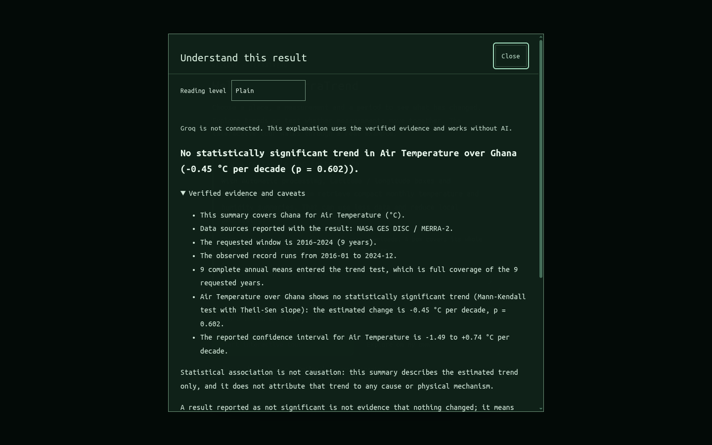
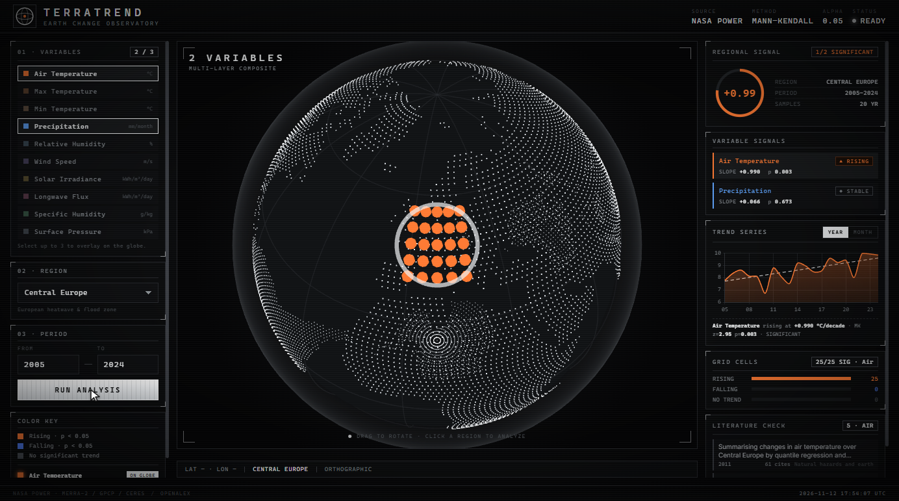
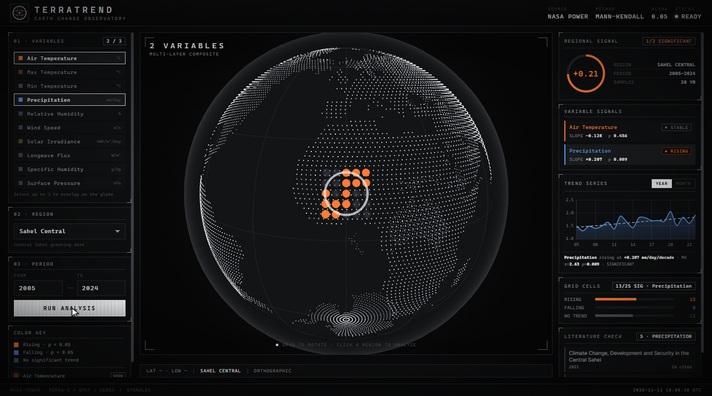
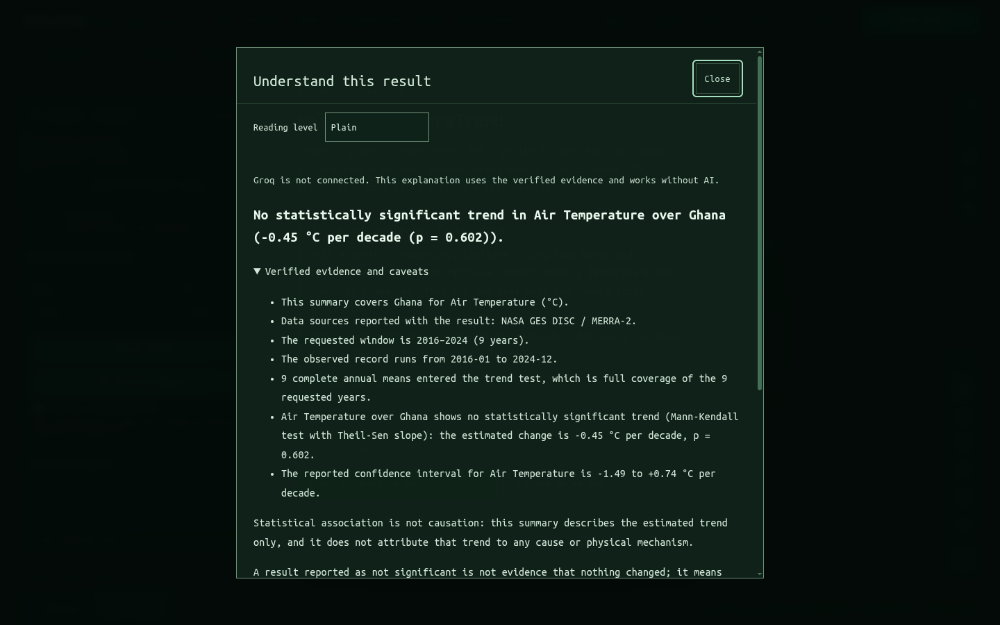
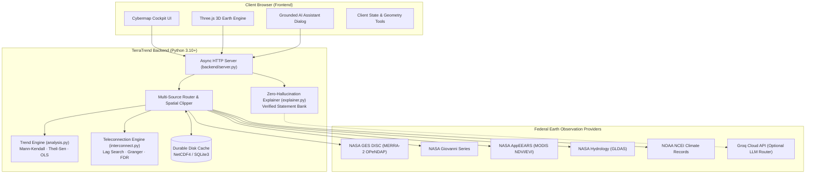

# TerraTrend — Earth Change Observatory

[](https://www.spaceappschallenge.org/2026/challenges/earth-system-trend-detective/)
[](https://www.python.org/)
[](https://threejs.org/)
[](LICENSE)
[](tests)

> **"Be An Earth System Trend Detective!" — NASA Space Apps Challenge 2026**  
> TerraTrend turns multi-decadal, raw NASA satellite and reanalysis observations into statistically rigorous, human-understandable environmental change intelligence. Pick any variable, choose any country, subnational region, or custom hand-drawn boundary on a photorealistic 3D Earth, and instantly discover **what** is changing, **where**, **by how much**, and whether the change is **statistically real**.

---

## 🗺️ Table of Contents

- [1. What is TerraTrend?](#1-what-is-terratrend)
- [2. The Real-World Challenge](#2-the-real-world-challenge)
- [3. Key Features at a Glance](#3-key-features-at-a-glance)
- [4. Visual Interface Tour](#4-visual-interface-tour)
- [5. System Architecture](#5-system-architecture)
- [6. Deep-Dive Specialized Documentation](#6-deep-dive-specialized-documentation)
- [7. Quickstart & Installation](#7-quickstart--installation)
- [8. Cloud Deployment Guide](#8-cloud-deployment-guide)
  - [Deploy on Render (Recommended)](#deploy-on-render-recommended)
  - [Deploy on Vercel](#deploy-on-vercel)
  - [Environment Configuration](#environment-configuration)
- [9. Testing & Scientific Verification](#9-testing--scientific-verification)
- [10. Team & Collaboration](#10-team--collaboration)
- [11. Acknowledgments & Data Providers](#11-acknowledgments--data-providers)

---

## 1. What is TerraTrend?

An environmental variable can trend upwards in one region and downwards in another, even when driven by the exact same planetary process. With petabytes of open satellite observations spread across dozens of scientific portals, students, journalists, and policy analysts face a daunting barrier: **How do we know if an environmental change is a genuine multi-decadal trend or just normal natural year-to-year fluctuation?**

**TerraTrend** bridges this gap. It combines:
1. **Direct NASA Multi-Source Ingestion**: Pulls verified monthly observations directly from NASA GES DISC (MERRA-2 via OPeNDAP), NASA Giovanni, NASA AppEEARS (MODIS vegetation), NASA Hydrology (GLDAS), and NOAA NCEI.
2. **Non-Parametric Trend Statistics**: Evaluates decadal change rates using **Theil–Sen robust median slope estimation** and tests significance via the **Mann–Kendall test**, equipped with **AR(1) serial correlation variance inflation** to eliminate false alarms.
3. **Planetary 3D Cybermap**: An interactive 3D WebGL globe with atmospheric scattering, realistic day/night lighting terminators, administrative boundary meshes, and custom freehand lasso inspection tools.
4. **Earth System Interconnectivity**: A teleconnection discovery engine that identifies directional leads and physical couplings across spheres (Atmosphere, Hydrosphere, Biosphere) with **Benjamini–Hochberg False Discovery Rate (FDR)** control.
5. **Grounded AI Assistant & Explainer**: A natural-language interface that translates complex statistical evidence into **Plain**, **Student**, or **Researcher** reading levels using a safe, zero-hallucination verified statement architecture.

---

## 2. The Real-World Challenge

When investigating climate and environmental datasets, standard analytical tools make dangerous statistical mistakes:

| The Trap | What Naive Tools Do | How TerraTrend Solves It |
|---|---|---|
| **The Sawtooth Trap** | Running trend tests on raw monthly data, where annual seasonal swings ($\pm 15^\circ\text{C}$) bury the decadal signal ($\sim 0.2^\circ\text{C}$/decade), falsely claiming "no trend" ($p > 0.50$). | Collapses complete calendar years into annual means, or deploys the **Hirsch–Slack seasonal Mann-Kendall** test to compare Januaries only to Januaries. |
| **Autocorrelation Inflation** | Assuming observations are independent. Climate series have physical memory ($r_1 > 0$), which artificially deflates variance and produces massive false-positive rates ($p < 0.001$). | Applies **AR(1) variance correction on detrended Theil–Sen residuals**, with an enforced variance floor to guarantee conservative, honest significance. |
| **Outlier Sensitivity** | Using ordinary linear regression (least squares), where a single anomalous heatwave or volcanic year bends the whole trendline. | Employs the **Theil–Sen estimator** (median of all pairwise slopes), which resists up to $29.3\%$ extreme outliers. |
| **p-Hacking Across Regions** | Testing hundreds of pairwise variables across dozens of regions and claiming any pair with $p < 0.05$ is a "discovery." | Enforces **Benjamini–Hochberg False Discovery Rate (FDR)** control, pruning random noise from genuine teleconnections. |

---

## 3. Key Features at a Glance

### 🌍 Interactive 3D Earth Cockpit
- Photorealistic 3D globe with dynamic day/night solar terminator, procedural clouds, and atmospheric limb glow.
- Explore at any scale: **Continent**, **Subcontinent**, **Country**, and subnational administrative divisions (ADM1).
- Flexible selection tools: pick sovereign borders, preset study rectangles, or draw freehand **Lassos**, **Bounding Boxes**, or **Adjustable Centroid Circles**.
- True spherical geometry: clips grid cells to exact polygon boundaries and applies **$\cos(\text{latitude})$ area-weighting**.

### 📈 Dual-Method Statistical Engine
- **Theil–Sen Robust Slope**: Reports rate of change in physical units per decade ($\Delta \text{unit}/\text{decade}$) alongside Gilbert (1987) non-parametric confidence intervals.
- **Mann–Kendall Significance**: Evaluates whether directional changes exceed random noise ($p < 0.05$), with tie corrections and serial correlation adjustments.
- **Parametric Cross-Check**: Runs Ordinary Least Squares (OLS) linear regression with Student's $t$-tests in parallel, providing an explicit **AGREES / DISAGREES** diagnostic report.

### 🔄 Comparative Regional Analysis (A vs. B)
- Directly compare two independent areas (e.g., Primary Area A vs. Comparison Area B).
- Constructs a **calendar-aligned paired difference time series ($A - B$)**, preserving spatial covariance between regions rather than assuming statistical independence.
- Produces clear verdicts: *Localized Signal*, *Divergent / Opposing*, *Different Rates*, or *No Significant Difference*.

### 🌐 Earth System Teleconnections & Interconnections
- Automatically deconstructs monthly series into **Linear Trend + Seasonal Climatology + Residual Anomaly**.
- Discovers directional leads between remote regions using lagged cross-correlation ($-\tau$ to $+\tau$) with Quenouille–Bartlett effective sample size corrections ($N_{\text{eff}}$).
- Screens out common atmospheric drivers via first-order partial correlation and checks predictive causality via two-way **Granger $F$-tests**.

### 💬 Grounded AI Assistant & Multi-Tier Explainer
- Natural language query interface: *"Scan all variables in Ghana from 2016 to 2024"*, *"Compare air temperature between Ghana and Nigeria"*.
- **Zero-Hallucination Architecture**: The AI never invents numbers or causal claims. It selects and sequences pre-audited canonical scientific statements keyed to computed evidence hashes.
- Select your preferred reading level: **Plain** (accessible analogies for the public), **Student** (curriculum-aligned definitions and concepts), or **Researcher** (rigorous mathematical statistics).

### 📖 Curated Climate Events & Interactive Walkthroughs
- Deep-dive into 6 historical climate events: El Niño teleconnections, Ghana & West African drought, Amazon basin drying, Southern African drought, Arctic sea-ice collapse, and active anomaly watches.
- Interactive 4-step guided lessons that teach users how to explore data on the globe with verifiable hands-on clicks.

---

## 4. Visual Interface Tour

| Planetary 3D Cybermap Cockpit | Regional Trend Analysis & Time Series |
|:---:|:---:|
|  |  |
| *Photorealistic 3D globe with draggable investigation panels, telemetry dials, and glowing trend vectors.* | *Annual time series with robust Theil–Sen slope line, confidence intervals, and dual-method diagnostics.* |

| Multi-Variable Regional Comparison | Spatial Anomaly Patterns |
|:---:|:---:|
|  |  |
| *Contrasting multiple climatic variables simultaneously across sovereign and ecological boundaries.* | *High-resolution planetary relief showing day/night terminator and global coordinate raycasting.* |

---

## 5. System Architecture

TerraTrend is engineered as a unified, high-performance web platform combining a pure-Python scientific computing engine with a modern Three.js frontend.



---

## 6. Deep-Dive Specialized Documentation

To keep this primary showcase accessible while providing complete scientific and engineering rigor, detailed technical topics are documented in specialized companion guides:

- 📊 **[Statistical & Mathematical Methodology](docs/ANALYSIS_AND_STATISTICS.md)**  
  *Exhaustive textbook-grade reference covering the Mann-Kendall test, tie corrections, AR(1) variance inflation derivations, Theil–Sen estimator, Gilbert confidence intervals, Lentz continued fractions, and the Benjamini–Hochberg FDR algorithm.*
- 🤖 **[Human-in-the-Loop AI Collaboration & System Attribution](docs/AI_COLLABORATION_AND_ATTRIBUTION.md)**  
  *Transparent disclosure on how human domain expertise drove the scientific formulation, while AI tools served as code scaffolding and design velocity accelerators. Details the in-product Zero-Hallucination Explainer architecture.*
- 👥 **[Team, Roles & Contributions](docs/TEAM_AND_CONTRIBUTIONS.md)**  
  *Roster of team members (Kwame Brown & Asenso Owusu Ansah), individual architectural ownership, project milestones, and NASA Space Apps Challenge context.*
- 🛰️ **[Data Sources, Presets & Ingestion Mechanics](docs/SOURCES_AND_PRESETS.md)**  
  *Complete mapping of 20 live environmental variables, unit conversion formulas, OPeNDAP byte-range subsetting, AppEEARS token authorization, and caching protocols.*
- 🧪 **[Local Verification & Empirical Evidence](docs/LOCAL_VERIFICATION.md)**  
  *Audited test runs verifying 240 months of real NASA NetCDF4 binary granules for Ghana and Europe, confirming zero data hallucination.*
- 🌍 **[AI Assistant & Curated Climate Events](docs/AI_ASSISTANT_AND_EVENTS.md)**  
  *Operational guide to the natural language assistant, privacy configuration, and the 6 curated climate event walkthroughs.*
- 🏛️ **[Official Challenge Resources](docs/CHALLENGE_RESOURCES.md)**  
  *Audit of all 13 official NASA Space Apps 2026 challenge resources and their integration status in TerraTrend.*

---

## 7. Quickstart & Installation

TerraTrend is built to the **universal clone-and-run standard**: no hardcoded machine paths, zero proprietary cloud locks, and automatic dependency management.

### Prerequisites
- **Python**: Version `3.10` or higher (`python3 --version`)
- **System Libraries**: NetCDF4/HDF5 C libraries (automatically available on most systems; install via `apt install libnetcdf-dev libhdf5-dev` on Debian/Ubuntu if building NetCDF4 from source).
- **Node.js** (Optional, for running frontend contract test suites): Version `>= 18`.

### One-Command Local Startup (Linux / macOS / WSL)

1. Clone the repository:
   ```bash
   git clone https://github.com/holmes1560/Terratrend.git
   cd Terratrend
   ```
2. Launch using the startup script:
   ```bash
   ./start.sh 8517
   ```
3. Open your browser at **`http://127.0.0.1:8517`**.

*The startup script automatically creates an isolated Python virtual environment (`.venv`), installs all required packages from `requirements.txt`, and starts the server.*

### Running via Docker

TerraTrend includes a multi-stage `Dockerfile` with pre-compiled scientific libraries:

```bash
docker build -t terratrend .
docker run -p 8517:8517 terratrend
```

---

## 8. Cloud Deployment Guide

### Deploy on Render (Recommended)

TerraTrend includes a pre-configured `render.yaml` Blueprint and `Procfile`. Render hosts the Python computational engine, disk cache, background worker queue, and frontend together on a single domain with zero CORS issues.

1. Push your fork to GitHub.
2. In the [Render Dashboard](https://dashboard.render.com), click **New +** ➔ **Blueprint**.
3. Select your repository. Render automatically reads `render.yaml` and provisions the service.

### Deploy on Vercel

A `vercel.json` configuration is included. Vercel serves the static frontend assets and proxies API calls to your live backend:

```bash
npx vercel
```

### Environment Configuration

Copy `.env.example` to `.env` to configure optional server parameters:

```bash
cp .env.example .env
```

| Environment Variable | Required | Default | Description |
|---|:---:|:---:|---|
| `HOST` | No | `0.0.0.0` | Network interface to bind |
| `PORT` | No | `8517` | Server port (`PORT` is auto-assigned on Render) |
| `EARTHDATA_TOKEN` | No | `""` | NASA Earthdata bearer token for automatic satellite queries |
| `APPEEARS_TOKEN` | No | `""` | NASA AppEEARS token for vegetation indices |
| `GROQ_API_KEY` | No | `""` | Optional Groq API key for AI assistant explanations |
| `TERRATREND_GROQ_MODEL` | No | `llama-3.3-70b-versatile` | Groq LLM model identifier |

*Note: All credentials can also be entered directly and privately in the browser under **Data & Methods** without saving them to the server.*

---

## 9. Testing & Scientific Verification

TerraTrend enforces strict evidence-first verification before any code ships. To execute the automated test suites:

```bash
# 1. Run Python statistical and backend test suite (371+ tests)
.venv/bin/python -m pytest backend -q -p no:cacheprovider

# 2. Run frontend contract integration tests (102 tests)
node --test tests/*.test.cjs

# 3. Verify frontend JavaScript syntax
node --check frontend/app.js
node --check frontend/earth-renderer.js
node --check frontend/workflow.js
node --check frontend/selection-tools.js
node --check frontend/map-panels.js
```

---

## 10. Team & Collaboration

TerraTrend was engineered for the **NASA Space Apps Challenge 2026** by:

- **Kwame Brown** ([@brownkwame323](https://github.com/brownkwame323)): Lead Geospatial & 3D Visualization Engineer  
  *Three.js planetary rendering, photoreal Earth shaders, day/night terminators, Cybermap UI, and frontend contracts.*
- **Asenso Owusu Ansah** ([@holmes1560](https://github.com/holmes1560)): Lead Backend Systems & Climate Data Architect  
  *Statistical computing engine (Mann-Kendall, Theil-Sen), Earth-system teleconnection pipeline, NASA OPeNDAP integration, and cloud containerization.*

Read the full story in **[Team, Roles & Contributions](docs/TEAM_AND_CONTRIBUTIONS.md)**.

---

## 11. Acknowledgments & Data Providers

- **NASA Space Apps Challenge 2026** for the inspiration and challenge framework.
- **NASA GES DISC** for MERRA-2 reanalysis and Giovanni time-series access.
- **NASA LP DAAC** for AppEEARS MODIS NDVI/EVI processing.
- **NOAA NCEI** for global GSOM surface station climatologies.
- **Natural Earth** for public-domain 1:50m cartographic boundaries.
