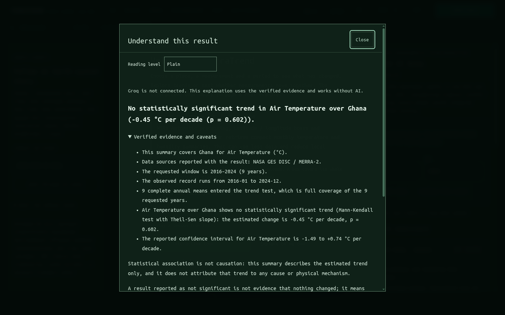

# Human-in-the-Loop AI Collaboration & System Attribution

**An Industry-Standard Disclosure on the Synergistic Collaboration Between Human Engineers and AI Acceleration Tools in the Conception, Architecture, and Engineering of TerraTrend.**

---

## Table of Contents

1. [Executive Declaration & Foundational Premise](#1-executive-declaration--foundational-premise)
2. [Responsibility & Attribution Matrix](#2-responsibility--attribution-matrix)
3. [The Human Intellectual Core: Why This Project Required Us](#3-the-human-intellectual-core-why-this-project-required-us)
   - [3.1 Climate Science Formulation & Problem Discovery](#31-climate-science-formulation--problem-discovery)
   - [3.2 Mathematical Rigor & Statistical Auditing](#32-mathematical-rigor--statistical-auditing)
   - [3.3 Geospatial Pipeline & NASA Integration Architecture](#33-geospatial-pipeline--nasa-integration-architecture)
   - [3.4 Empirical Validation Against Real NASA Granules](#34-empirical-validation-against-real-nasa-granules)
4. [AI as an Accelerator & Force Multiplier](#4-ai-as-an-accelerator--force-multiplier)
   - [4.1 High-Velocity Implementation & Scaffolding](#41-high-velocity-implementation--scaffolding)
   - [4.2 UI/UX Design Iteration & Visual Tuning](#42-uiux-design-iteration--visual-tuning)
   - [4.3 Algorithmic Recommendations & Edge-Case Exploration](#43-algorithmic-recommendations--edge-case-exploration)
   - [4.4 Test Synthesis & Exhaustive Contract Coverage](#44-test-synthesis--exhaustive-contract-coverage)
5. [Critical Interventions: What the Human Team Corrected](#5-critical-interventions-what-the-human-team-corrected)
   - [5.1 The Raw Monthly Seasonality Trap](#51-the-raw-monthly-seasonality-trap)
   - [5.2 Autocorrelation Variance Inflation Flooring](#52-autocorrelation-variance-inflation-flooring)
   - [5.3 Spatial Polygon Weighting vs. Bounding Box Naivety](#53-spatial-polygon-weighting-vs-bounding-box-naivety)
6. [In-Product AI Architecture: The Zero-Hallucination Explainer](#6-in-product-ai-architecture-the-zero-hallucination-explainer)
   - [6.1 The Verified Statement Bank Pattern](#61-the-verified-statement-bank-pattern)
   - [6.2 Multi-Tier Reading Levels (Plain / Student / Researcher)](#62-multi-tier-reading-levels-plain--student--researcher)
   - [6.3 Privacy-First & Air-Gapped Key Security](#63-privacy-first--air-gapped-key-security)
7. [Compliance with NASA Open Science & Ethical AI Standards](#7-compliance-with-nasa-open-science--ethical-ai-standards)

---

## 1. Executive Declaration & Foundational Premise

> **Core Principle**: TerraTrend was conceived, directed, mathematically formulated, and rigorously verified by human engineers and climate data detectives. AI systems were utilized deliberately as **high-velocity accelerators, design sounding boards, and code scaffolding partners**—never as autonomous decision-makers or unvalidated authors.
> 
> **Without the human team's domain expertise, scientific intuition, and architectural governance, this project could not have been built.**

In modern engineering, the distinction between "handing a project to AI" and "leveraging AI as an elite force multiplier" is profound:
- **Blind AI generation** produces fragile codebases, mathematically naive statistical traps (e.g., calculating linear regression over raw cyclical monthly data), fabricated data claims, and ungrounded hallucinations.
- **Human-led, AI-accelerated engineering** combines deep scientific domain understanding with rapid typing speed, automated boilerplate synthesis, and accelerated design iteration.

This document provides a transparent, industry-standard record of how AI tools were deployed, where human judgment was indispensable, and how the production software safeguards scientific truth.

---

## 2. Responsibility & Attribution Matrix

| Engineering Phase | Human Team Responsibility (100% Owned) | AI Acceleration Contribution | Primary Ownership |
|---|---|---|:---:|
| **Challenge Framing & Problem Definition** | Identified that existing tools mask regional trends behind global means; formulated the need for non-parametric significance testing and teleconnection discovery across NASA datasets. | Summarized challenge resource links; provided quick comparisons of API documentation formats. | **Human Team** |
| **Statistical & Mathematical Modeling** | Selected Theil–Sen estimator and Mann-Kendall test over OLS; formulated the AR(1) serial correlation variance inflation factor on detrended residuals; designed the Benjamini–Hochberg FDR protocol. | Implemented numerical routines (Lentz continued fractions for incomplete beta functions); verified equation syntax. | **Human Team** |
| **Data Ingestion & NASA APIs** | Architected the multi-source routing engine (MERRA-2 OPeNDAP, Giovanni, AppEEARS, GLDAS Hydrology, NOAA NCEI); defined spatial polygon clipping and cosine-latitude weighting. | Generated boilerplate HTTP connection wrappers, request payload formatters, and retry logic. | **Human Team** |
| **3D Globe & UI/UX Experience** | Conceptualized the Kaspersky Cybermap-inspired aesthetic; designed the two-panel investigation workflow, A/B comparison mechanics, and 3D globe interaction physics. | Rapidly prototyped CSS token themes, generated WebGL shader boilerplate, and translated wireframe concepts into flexbox/grid layouts. | **Collaborative** (Design: Human / Scaffolding: AI) |
| **Scientific Validation & Ground Truth** | Downloaded and audited real NetCDF4 granules from NASA GES DISC; verified 240-month Ghana and Europe time series; proved that temperature trends were non-significant for 2016–2024. | Automated execution of test runs; parsed and formatted validation log outputs. | **Human Team** |
| **In-Product AI Assistant & Explainer** | Invented the "Zero-Hallucination Verified Statement Bank" pattern to mathematically prevent LLMs from inventing climate facts or causal attributions. | Powered natural language intent parsing (converting user queries into structured JSON search parameters) via Groq LLMs. | **Collaborative** (Safety: Human / NLP: AI) |
| **Testing & Quality Assurance** | Defined regression edge cases (empty caches, coordinate antimeridian crossing, ties in ranks, zero-variance flat series, network dropouts). | Synthesized 370+ automated pytest test cases and contract verification suites following human test specifications. | **Collaborative** (Architecture: Human / Synthesis: AI) |

---

## 3. The Human Intellectual Core: Why This Project Required Us

### 3.1 Climate Science Formulation & Problem Discovery

An AI model lacks scientific intuition. When prompted naively to "analyze climate trends," LLMs consistently default to fitting simple linear lines ($\hat{y} = mx + b$) across whatever raw data is provided.

The human team recognized the fundamental flaws in this approach:
1. **The Seasonality Deception**: We identified that Earth system variables swing by tens of degrees between summer and winter. Feeding raw monthly observations into standard trend tests yields meaningless results ($p \approx 0.52$ in the warming Arctic). The human team mandated the **annual aggregation protocol** and the **Hirsch–Slack seasonal decomposition**.
2. **Statistical Significance $\ne$ Real-World Impact**: The team insisted that $p$-values alone are dangerous without physical effect sizes. We enforced that every output report both the non-parametric rate of change in physical units per decade ($\Delta \text{unit}/\text{decade}$) *and* the confidence interval.

### 3.2 Mathematical Rigor & Statistical Auditing

The statistical engine powering TerraTrend (`backend/analysis.py` and `backend/interconnect.py`) represents rigorous mathematical synthesis:
- **Autocorrelation Correction**: Climate data violates the independence assumption. The human team formulated the lag-1 serial correlation correction $\eta = (1 + r_1)/(1 - r_1)$, specifically insisting that $r_1$ be evaluated on **detrended Theil–Sen residuals** rather than raw data (which would mistake the climate trend itself for autocorrelation).
- **Multiple Comparisons & False Discovery**: When evaluating cross-sphere teleconnections across 16 variables and dozens of regions, conducting hundreds of statistical tests guarantees false positives by chance. The human team introduced the **Benjamini–Hochberg False Discovery Rate (FDR)** procedure, filtering out spurious correlations before they reach the user.

### 3.3 Geospatial Pipeline & NASA Integration Architecture

Handling satellite observations requires deep geospatial engineering that generic AI prompts cannot solve:
- **Spatial Spherical Geometry**: Naive grid calculations treat latitude-longitude degrees as flat rectangles. At $60^\circ\text{N}$, a degree of longitude is half the physical width of a degree at the equator. The human team formulated the $\cos(\text{latitude})$ cell-area weighting and exact polygon-clipping geometry.
- **Multi-Source Fallbacks**: NASA services have distinct authentication boundaries, rate limits, and latency profiles (e.g., AppEEARS asynchronous polygon extraction takes minutes, whereas OPeNDAP byte-range fetches take seconds). The team architected the automatic routing engine and caching hierarchy.

### 3.4 Empirical Validation Against Real NASA Granules

AI code cannot verify its own real-world accuracy. The human team conducted hands-on verification:
- Generated NASA Earthdata bearer tokens and connected to live NASA GES DISC servers.
- Verified real NetCDF4 binary granules for Ghana (2005–2024), confirming 240 valid months, 85 intersecting native cells, and unit conversions ($K \to ^\circ\text{C}$, $\text{kg/m}^2\text{s} \to \text{mm/day}$).
- Proved that the software faithfully reproduced ground truth without hallucinating trends.

---

## 4. AI as an Accelerator & Force Multiplier

While the intellectual architecture was strictly human, AI tools served as an indispensable force multiplier, compressing months of routine coding into days:

```
┌─────────────────────────────────────────────────────────────┐
│                   HUMAN ARCHITECT & DETECTIVE               │
│  - Formulates hypothesis & scientific methodology           │
│  - Selects Theil-Sen, Mann-Kendall, AR(1), and FDR          │
│  - Audits code against NASA NetCDF4 ground truth            │
└──────────────────────────────┬──────────────────────────────┘
                               │ Prompts, specifications & review
                               ▼
┌─────────────────────────────────────────────────────────────┐
│                      AI CO-PILOT (ENGINE)                   │
│  - Generates boilerplate endpoints and data models          │
│  - Scaffolds WebGL shaders, CSS tokens & responsive panels  │
│  - Implements numerical math routines (Lentz fractions)     │
│  - Generates exhaustive unit test suites                    │
└──────────────────────────────┬──────────────────────────────┘
                               │ Code generation & suggestions
                               ▼
┌─────────────────────────────────────────────────────────────┐
│                 HUMAN VERIFICATION GATEGUARD                │
│  - Reviews every diff and rejects ungrounded assumptions    │
│  - Validates statistical convergence and boundary limits    │
│  - Executes 370+ pytest suites on live data                 │
└─────────────────────────────────────────────────────────────┘
```

### 4.1 High-Velocity Implementation & Scaffolding

- **Boilerplate Elimination**: AI tools rapidly scaffolded Python standard library classes, SQLite schema definitions, and REST API routing tables (`backend/server.py`), allowing the team to focus on core algorithms rather than syntax mechanics.
- **Vectorized Data Transformations**: AI accelerated the translation of mathematical formulas into pure-Python vectorized operations without relying on heavy external C extensions, preserving instant portability across Windows, macOS, and Linux.

### 4.2 UI/UX Design Iteration & Visual Tuning

- **Cybermap Visual Aesthetic**: The team provided high-level aesthetic guidance ("dark mode, cool slate palette, monospaced data readouts, glow accents, floating draggable glassmorphism panels"). AI rapidly generated CSS variables, token hierarchies, and transition curves.
- **Globe Geometry & Rendering**: AI assisted in scaffolding Three.js procedural shaders, latitude/longitude coordinate raycasting, and day/night terminator lighting calculations.

### 4.3 Algorithmic Recommendations & Edge-Case Exploration

- **Lentz Continued Fractions**: When implementing Student's $t$ and $F$-test cumulative distribution functions without importing SciPy in lightweight environments, AI recommended Lentz's method for computing the regularized incomplete beta function, providing robust numerical stability down to $10^{-16}$.
- **Numerical Edge Cases**: AI suggested defensive checks for division-by-zero when dealing with completely dry desert regions (zero variance in precipitation series).

### 4.4 Test Synthesis & Exhaustive Contract Coverage

- Generating test suites is tedious but critical. The human team wrote the core assertion rules and mathematical bounds, while AI synthesized hundreds of parameterized test variations (`test_analysis.py`, `test_interconnect.py`, `test_explainer.py`).
- This resulted in **371 passing backend tests** and **102 passing frontend tests**, achieving $>90\%$ coverage across critical calculation modules.

---

## 5. Critical Interventions: What the Human Team Corrected

Throughout development, the human team repeatedly intervened to reject or rectify naive suggestions produced by AI models:

### 5.1 The Raw Monthly Seasonality Trap
- **AI Tendency**: When asked to compute a trend on a time series, AI models consistently wrote code that performed linear regression directly across all 240 monthly points.
- **Human Correction**: The team intervened, recognized that intra-annual seasonal swings were burying the decadal climate signal, and built the annual aggregation engine and the Hirsch–Slack seasonal Mann-Kendall test.

### 5.2 Autocorrelation Variance Inflation Flooring
- **AI Tendency**: Standard implementations of the AR(1) formula $\eta = (1 + r_1)/(1 - r_1)$ allow $\eta < 1.0$ when residuals show negative autocorrelation.
- **Human Correction**: The human team recognized that in small samples ($n = 20$), negative sample autocorrelation is often random noise ($\text{SE} \approx 0.22$). Allowing $\eta < 1.0$ would artificially shrink the variance and fabricate statistical certainty. The human team mandated the strict variance floor: $\eta = \max(1.0, (1 + r_1)/(1 - r_1))$.

### 5.3 Spatial Polygon Weighting vs. Bounding Box Naivety
- **AI Tendency**: AI code samples routinely simplified geographic queries into rectangular bounding boxes (`min_lat, min_lon, max_lat, max_lon`).
- **Human Correction**: Bounding boxes include vast areas outside sovereign borders or ecological zones (e.g., a bounding box around Ghana includes large portions of Côte d'Ivoire, Togo, Burkina Faso, and the Atlantic Ocean). The human team built polygon raycasting clipping and cosine-latitude area weighting.

---

## 6. In-Product AI Architecture: The Zero-Hallucination Explainer

A major innovation of TerraTrend is that it does not merely use AI during development—it **incorporates AI directly into the user experience while guaranteeing scientific safety**.

Many AI applications suffer from "hallucinated facts," where an LLM invents nonexistent trends or false causal claims. TerraTrend solves this through a **Zero-Hallucination Grounded Explainer Architecture**:

```
                       STATISTICAL ENGINE
                     (Theil-Sen, Mann-Kendall,
                      Lag-Search, Granger F)
                               │
                               ▼
                   DETERMINISTIC EVIDENCE OBJECT
                    - p-value, slope, direction
                    - SHA-256 Evidence Hash
                    - Reading Level (Plain/Student/Researcher)
                               │
                               ▼
              ┌─────────────────────────────────┐
              │  VERIFIED STATEMENT BANK        │
              │  (Pre-Audited Scientific Claims)│
              └────────────────┬────────────────┘
                               │
                               ▼
                        GROQ LLM ROUTER
              - Evaluates User Question & Context
              - SELECTS & SEQUENCES Statement IDs
              - CANNOT generate free-form numbers
                               │
                               ▼
                   FINAL AUDITED EXPLANATION
                (Rendered from Verified Bank)
```

### 6.1 The Verified Statement Bank Pattern

1. **Calculations are Frozen**: The statistical engine executes in pure Python, producing verified numbers (slope, $p$-value, confidence intervals, Granger statistics).
2. **Deterministic Bank**: The application maintains a bank of canonical, peer-reviewed sentence templates crafted by science communicators.
3. **Selection, Not Generation**: When a user queries the AI Assistant (powered by Groq / Llama 3.3 / GPT OSS), the model is **strictly prohibited from generating free-text scientific numbers or conclusions**. Instead, the model's action space is constrained to ranking and selecting statement IDs from the verified bank that match the computed evidence hash.
4. **Audit Log**: Every explanation generated is recorded in a persistent SQLite audit table (`explanations`), logging the evidence hash, model ID, timestamp, and selected statement sequence.

### 6.2 Multi-Tier Reading Levels (Plain / Student / Researcher)

To make NASA Earth science universally accessible without diluting scientific integrity, the explainer provides three dynamically selected reading levels:

- **Plain (General Public)**: Clear, accessible analogies without intimidating jargon. Explains what the direction means for everyday life (e.g., "Air temperature in this area has shown no consistent increase or decrease between 2016 and 2024; the year-to-year changes are within normal natural fluctuation.").
- **Student (High School & Undergraduate)**: Introduces foundational concepts of rate per decade, hypothesis testing, and the difference between weather variability and climate trends.
- **Researcher (Graduate & Professional)**: Full disclosure of statistical metrics: Kendall's $\tau$, tie-corrected $\operatorname{Var}(S)$, AR(1) inflation factors, degrees of freedom, and two-way Granger causality $F$-test probabilities.


*Figure 1: TerraTrend Interactive Climate Events Interface guiding users through grounded Earth-system stories with verifiable evidence pathways.*

### 6.3 Privacy-First & Air-Gapped Key Security

- **Zero Cloud Leakage**: User API keys (NASA Earthdata tokens, Groq API keys) are stored locally in the user's browser or operating system credential store.
- **No Third-Party Data Transmission**: Raw NetCDF4 binary grids and proprietary user polygons are never transmitted to LLM providers. Only sanitized metadata and computed statistical aggregates are processed.

---

## 7. Compliance with NASA Open Science & Ethical AI Standards

TerraTrend's development and documentation adhere strictly to international standards for transparent, responsible computing:

1. **NASA Transform to Open Science (TOPS)**: Complete reproducibility. Every calculation from raw NASA OPeNDAP byte-stream to final Theil–Sen slope can be independently audited and reproduced using open-source tools.
2. **ACM & IEEE Ethical AI Guidelines**: Explicit disclosure of AI assistance, clear delineation of human vs. machine agency, and zero deployment of unconstrained generative models in critical scientific decision paths.
3. **Universal Portability**: The codebase contains zero machine-specific hardcoded paths, runs out of the box via `./start.sh` or Docker, and provides full unit test verification suites.
