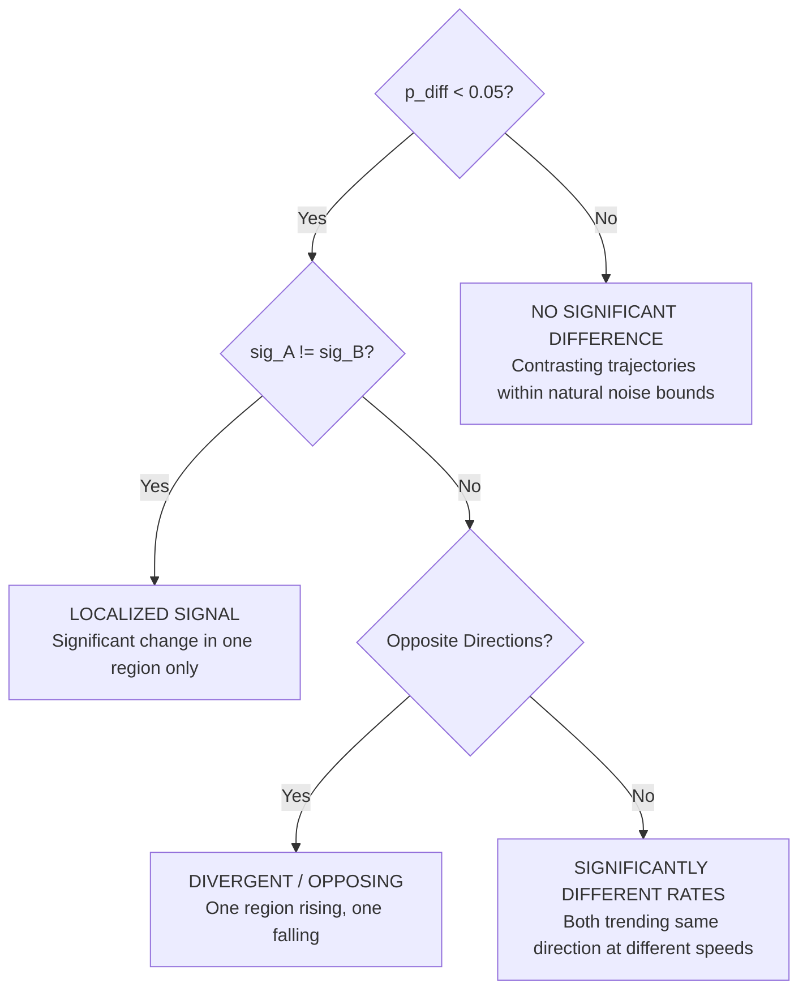

# TerraTrend: Statistical & Mathematical Methodology

**A Comprehensive Reference on Climate Time-Series Analysis, Non-Parametric Inference, Spatial Aggregation, and Teleconnection Dynamics in the Earth System.**

---

## Table of Contents

1. [Executive Summary & Problem Statement](#1-executive-summary--problem-statement)
2. [Temporal Aggregation & De-Seasoning](#2-temporal-aggregation--de-seasoning)
   - [2.1 The Sawtooth Seasonality Trap](#21-the-sawtooth-seasonality-trap)
   - [2.2 Annual Aggregation Protocol](#22-annual-aggregation-protocol)
   - [2.3 Hirsch–Slack Seasonal Mann-Kendall Test](#23-hirschslack-seasonal-mann-kendall-test)
3. [Non-Parametric Trend Detection: Mann-Kendall Inference](#3-non-parametric-trend-detection-mann-kendall-inference)
   - [3.1 Mann-Kendall S-Statistic](#31-mann-kendall-s-statistic)
   - [3.2 Variance Calculation with Tie Correction](#32-variance-calculation-with-tie-correction)
   - [3.3 Standardized Z-Transformation & Continuity Correction](#33-standardized-z-transformation--continuity-correction)
   - [3.4 Hypothesis Testing & Two-Sided p-Values](#34-hypothesis-testing--two-sided-p-values)
   - [3.5 Kendall's Rank Correlation Coefficient (Tau)](#35-kendalls-rank-correlation-coefficient-tau)
4. [Serial Correlation & Autocorrelation Adjustments](#4-serial-correlation--autocorrelation-adjustments)
   - [4.1 The Mechanism of False Significance Inflation](#41-the-mechanism-of-false-significance-inflation)
   - [4.2 Lag-1 Autocorrelation Estimation on Detrended Residuals](#42-lag-1-autocorrelation-estimation-on-detrended-residuals)
   - [4.3 AR(1) Variance Inflation Factor](#43-ar1-variance-inflation-factor)
   - [4.4 The Conservative Variance Floor Rule](#44-the-conservative-variance-floor-rule)
5. [Robust Estimation of Trend Magnitude: Theil–Sen Median Slope](#5-robust-estimation-of-trend-magnitude-theilsen-median-slope)
   - [5.1 Pairwise Slope Formulation](#51-pairwise-slope-formulation)
   - [5.2 Breakdown Point and Resistance to Outliers](#52-breakdown-point-and-resistance-to-outliers)
   - [5.3 Gilbert (1987) Non-Parametric Confidence Intervals](#53-gilbert-1987-non-parametric-confidence-intervals)
6. [Parametric Benchmarking: OLS & Student's t-Test](#6-parametric-benchmarking-ols--students-t-test)
   - [6.1 Ordinary Least Squares Regression](#61-ordinary-least-squares-regression)
   - [6.2 Regularized Incomplete Beta Function via Lentz Continued Fractions](#62-regularized-incomplete-beta-function-via-lentz-continued-fractions)
   - [6.3 Dual-Method Diagnostic Matrix (MK vs OLS)](#63-dual-method-diagnostic-matrix-mk-vs-ols)
7. [Spatial Aggregation & Geometric Weighting](#7-spatial-aggregation--geometric-weighting)
   - [7.1 Polygon Clipping & Cell Intersections](#71-polygon-clipping--cell-intersections)
   - [7.2 Latitude-Area Weighting (Cosine Factor)](#72-latitude-area-weighting-cosine-factor)
   - [7.3 Strict Area Support Thresholding (>= 80%)](#73-strict-area-support-thresholding--80)
8. [Comparative Regional Contrast Dynamics (A vs B)](#8-comparative-regional-contrast-dynamics-a-vs-b)
   - [8.1 Calendar-Aligned Paired Difference Series](#81-calendar-aligned-paired-difference-series)
   - [8.2 Spatial Covariance Preservation vs Independent OLS Approximation](#82-spatial-covariance-preservation-vs-independent-ols-approximation)
   - [8.3 Contrast Verdict Taxonomy](#83-contrast-verdict-taxonomy)
9. [Earth System Interconnectivity & Teleconnection Engine](#9-earth-system-interconnectivity--teleconnection-engine)
   - [9.1 Tri-Component Time Series Decomposition (Alternating Projection)](#91-tri-component-time-series-decomposition-alternating-projection)
   - [9.2 Lagged Cross-Correlation & Optimal Shift Search](#92-lagged-cross-correlation--optimal-shift-search)
   - [9.3 Effective Sample Size Correction (N_eff)](#93-effective-sample-size-correction-n_eff)
   - [9.4 Confounder Control via First-Order Partial Correlation](#94-confounder-control-via-first-order-partial-correlation)
   - [9.5 Directional Lead Screening: Two-Way Granger Causality F-Test](#95-directional-lead-screening-two-way-granger-causality-f-test)
   - [9.6 Multiple-Hypothesis Correction: Benjamini–Hochberg False Discovery Rate (FDR)](#96-multiple-hypothesis-correction-benjaminihochberg-false-discovery-rate-fdr)
   - [9.7 Anomaly Episodes & Extreme Departure Tracking](#97-anomaly-episodes--extreme-departure-tracking)
   - [9.8 Joint Conditional Driver Regression Modeling](#98-joint-conditional-driver-regression-modeling)
10. [Biophysical Coupling Mechanics & Feedbacks](#10-biophysical-coupling-mechanics--feedbacks)
11. [Scientific Assumptions, Limitations & Boundary Conditions](#11-scientific-assumptions-limitations--boundary-conditions)

---

## 1. Executive Summary & Problem Statement

Earth system observations—such as surface temperature, soil moisture, precipitation, and vegetation vigor—are characterized by strong periodic seasonal cycles, non-Gaussian noise distributions, spatial autocorrelation across adjacent grid cells, and persistent temporal persistence (serial correlation).

A naive application of classical statistical methods (such as Ordinary Least Squares linear regression or standard Pearson correlation) to raw monthly climate observations results in severe scientific failures:
1. **Masked Trends**: Massive annual seasonal swings ($\pm 15^\circ\text{C}$) dwarf multi-decadal climate signals ($\sim 0.2^\circ\text{C}$/decade), rendering true trends statistically invisible ($p > 0.50$).
2. **False Significance (Type I Errors)**: Climate time series exhibit positive autocorrelation ($r_1 > 0$), where a hot year tends to follow a hot year. Classical tests assume independent and identically distributed (i.i.d.) observations; violating this assumption drastically underestimates the standard error and inflates false-alarm rates by 200–500%.
3. **Outlier Vulnerability**: Ephemeral weather events (volcanic eruptions, extreme single-month heatwaves, tropical cyclones) pull least-squares regression lines away from the true underlying trajectory.
4. **False Teleconnections (p-Hacking)**: Evaluating pairwise correlations across dozens of environmental variables and geographic regions without controlling the family-wise error rate inevitably surfaces spuriously "significant" relationships by pure random chance.

**TerraTrend** addresses every one of these vulnerabilities through a mathematically rigorous, fully automated analytical engine implemented natively in Python. The system delivers non-parametric trend detection, robust rate-of-change estimation, autocorrelation-adjusted variance scaling, calendar-aligned spatial contrast testing, and false-discovery-rate-controlled teleconnection screening.

---

## 2. Temporal Aggregation & De-Seasoning

### 2.1 The Sawtooth Seasonality Trap

Raw Earth observations collected at monthly resolutions are dominated by the Earth's axial tilt and annual orbit, creating a high-amplitude sawtooth pattern:

$$Y_t = T_t + S_t + \epsilon_t$$

Where:
- $T_t$ is the multi-year climate trend,
- $S_t$ is the periodic seasonal cycle ($S_t \approx S_{t+12}$),
- $\epsilon_t$ is the stochastic residual noise.

In middle and high latitudes, the amplitude of $S_t$ can exceed $30^\circ\text{C}$, whereas the multi-decadal trend $T_t$ may be on the order of $0.03^\circ\text{C}/\text{year}$. A standard monotonicity test applied directly to $Y_t$ evaluates transitions between consecutive months (e.g., July to August, January to February), where seasonal derivatives completely overwhelm the decadal slope. In early development, running naive tests on raw Arctic monthly series yielded $p \approx 0.52$ ("no trend"), failing to detect severe multi-decadal warming.

### 2.2 Annual Aggregation Protocol

To isolate $T_t$ without introducing artificial model parameters, TerraTrend applies strict **annual aggregation** as its primary pipeline:

$$\bar{Y}_k = \frac{1}{12} \sum_{m=1}^{12} Y_{k, m}$$

Where $\bar{Y}_k$ is the mean of year $k$, and $Y_{k, m}$ is the observation for month $m$ of year $k$.

- **Completeness Guard**: A calendar year is only accepted as valid if all 12 monthly observations are present ($n_{\text{valid}} = 12$). Incomplete years are strictly flagged and omitted from annual trend estimation to prevent seasonal bias (e.g., missing winter months falsely skewing the annual mean upward).
- **Power vs. Validity Tradeoff**: Aggregating 20 years from 240 months to 20 annual values reduces the nominal sample size $n$, making statistical significance harder to achieve. TerraTrend accepts this conservative tradeoff: a statistically conservative valid result is fundamentally superior to an artificially overpowered false positive.

### 2.3 Hirsch–Slack Seasonal Mann-Kendall Test

For scenarios where intra-annual seasonality must be analyzed directly without losing monthly granularity, TerraTrend implements the **Hirsch–Slack Seasonal Mann-Kendall test** (`seasonal_mk`):

The monthly time series is partitioned into $m = 12$ orthogonal seasonal subsets (all Januaries, all Februaries, ..., all Decembers):

$$S_{\text{total}} = \sum_{g=1}^{12} S_g, \quad \operatorname{Var}(S_{\text{total}}) = \sum_{g=1}^{12} \operatorname{Var}(S_g)$$

Where $S_g$ and $\operatorname{Var}(S_g)$ are the Mann-Kendall statistic and variance calculated exclusively within month subset $g$. Because observations from January in year $i$ are only compared against January in year $j$ ($j > i$), the seasonal cycle $S_t$ cancels out identically:

$$S_g = \sum_{i=1}^{n_g - 1} \sum_{j=i+1}^{n_g} \operatorname{sgn}(Y_{j, g} - Y_{i, g})$$

The standardized test statistic $Z_{\text{seasonal}}$ is then evaluated against the standard normal distribution $\mathcal{N}(0, 1)$.

---

## 3. Non-Parametric Trend Detection: Mann-Kendall Inference

The **Mann-Kendall test** (Mann 1945; Kendall 1975) is the primary non-parametric statistical hypothesis test recommended by the World Meteorological Organization (WMO) for detecting monotonic trends in environmental time series.

### 3.1 Mann-Kendall S-Statistic

Given an ordered time series of $n$ observations $Y = \{y_1, y_2, \dots, y_n\}$ recorded at time coordinates $X = \{x_1, x_2, \dots, x_n\}$, the Mann-Kendall statistic $S$ is defined as the sum of signs of all pairwise differences:

$$S = \sum_{i=1}^{n-1} \sum_{j=i+1}^{n} \operatorname{sgn}(y_j - y_i)$$

Where the sign function $\operatorname{sgn}(\theta)$ is defined as:

$$\operatorname{sgn}(\theta) = \begin{cases} +1 & \text{if } \theta > 0 \\ 0 & \text{if } \theta = 0 \\ -1 & \text{if } \theta < 0 \end{cases}$$

For $n$ observations, the total number of pairwise comparisons is:

$$\binom{n}{2} = \frac{n(n - 1)}{2}$$

- $S > 0$: Values later in the series systematically exceed earlier values (upward tendency).
- $S < 0$: Values later in the series are systematically lower (downward tendency).
- $S \approx 0$: No monotonic progression exists.

### 3.2 Variance Calculation with Tie Correction

Under the null hypothesis $H_0$ (the data are independent, identically distributed random variables with no temporal trend), the expected value of $S$ is zero:

$$\mathbb{E}[S] = 0$$

When the dataset contains identical numerical values (ties), the variance of $S$ is reduced. TerraTrend computes the exact tie-corrected variance:

$$\operatorname{Var}(S) = \frac{1}{18} \left[ n(n - 1)(2n + 5) - \sum_{k=1}^{p} t_k(t_k - 1)(2t_k + 5) \right]$$

Where:
- $p$ is the number of tied groups,
- $t_k$ is the extent (number of tied observations) within group $k$.

To prevent numerical instability in degenerately constant series, the engine floors $\operatorname{Var}(S)$ at $\epsilon = 10^{-12}$.

### 3.3 Standardized Z-Transformation & Continuity Correction

For $n \ge 8$, the sampling distribution of $S$ closely approximates a normal distribution. A continuity correction of $\pm 1$ is applied to account for the discrete nature of $S$:

$$Z = \begin{cases} \frac{S - 1}{\sqrt{\operatorname{Var}(S)}} & \text{if } S > 0 \\[8pt] 0 & \text{if } S = 0 \\[8pt] \frac{S + 1}{\sqrt{\operatorname{Var}(S)}} & \text{if } S < 0 \end{cases}$$

### 3.4 Hypothesis Testing & Two-Sided p-Values

The null hypothesis $H_0$ is evaluated against the two-sided alternative hypothesis $H_1$ (a monotonic upward or downward trend exists). The cumulative distribution function of the standard normal distribution is computed via the error function $\operatorname{erf}$:

$$\Phi(z) = \frac{1}{2} \left[ 1 + \operatorname{erf}\left( \frac{z}{\sqrt{2}} \right) \right]$$

$$\operatorname{erf}(u) = \frac{2}{\sqrt{\pi}} \int_0^u e^{-t^2} \, dt$$

The exact two-sided $p$-value is:

$$p = 2 \cdot \left[ 1 - \Phi(|Z|) \right]$$

- At significance level $\alpha = 0.05$, $H_0$ is rejected if $p < 0.05$ ($|Z| > 1.95996$).
- Significance notation:
  - $p < 0.01$: `***` (Extremely strong evidence)
  - $p < 0.05$: `**` (Statistically significant)
  - $p < 0.10$: `*` (Marginal / suggestive evidence)
  - $p \ge 0.10$: Non-significant (consistent with random fluctuation)

### 3.5 Kendall's Rank Correlation Coefficient (Tau)

Kendall's tau ($\tau$) measures the relative strength of monotonic association on a normalized $[-1, +1]$ scale:

$$\tau = \frac{S}{\frac{1}{2} n (n - 1)}$$

---

## 4. Serial Correlation & Autocorrelation Adjustments

### 4.1 The Mechanism of False Significance Inflation

The standard Mann-Kendall formulation assumes that observations are temporally independent. However, atmospheric, oceanic, and hydrological series possess physical memory (e.g., ocean thermal inertia, soil moisture retention, multiannual El Niño cycles).

When a time series exhibits positive lag-1 autocorrelation ($r_1 > 0$):
1. A warm year is likely to be followed by another warm year simply due to thermal persistence.
2. The effective number of independent degrees of freedom is smaller than the nominal sample count $n$.
3. The true variance of $S$ is significantly larger than the theoretical variance $\operatorname{Var}(S)$.
4. Applying the standard uncorrected variance produces an inflated $Z$-statistic and an artificially tiny $p$-value, causing false alarms (Type I error rates up to 40%).

### 4.2 Lag-1 Autocorrelation Estimation on Detrended Residuals

Estimating autocorrelation directly on raw series is fundamentally flawed: any strong monotonic trend will itself appear as high positive autocorrelation ($r_1 \to 1$), which would inappropriately cancel out real trends.

TerraTrend solves this by computing lag-1 autocorrelation exclusively on **detrended residuals**:

1. Fit the robust Theil–Sen line to the series: $\hat{y}_i = \beta_0 + \beta_1 x_i$.
2. Compute the residual departures: $e_i = y_i - \hat{y}_i$.
3. Compute the sample mean of residuals: $\bar{e} = \frac{1}{n} \sum_{i=1}^n e_i$.
4. Calculate the lag-1 autocorrelation coefficient $\hat{r}_1$:

$$\hat{r}_1 = \frac{\sum_{i=1}^{n-1} (e_i - \bar{e})(e_{i+1} - \bar{e})}{\sum_{i=1}^n (e_i - \bar{e})^2}$$

The coefficient is strictly clamped to $\hat{r}_1 \in [-0.99, 0.99]$ to avoid mathematical singularities.

### 4.3 AR(1) Variance Inflation Factor

Under a first-order autoregressive AR(1) process, the true variance of $S$ is scaled by the variance correction factor $\eta_{\text{AR1}}$ (Yue and Wang, 2004; Hamed and Rao, 1998):

$$\eta_{\text{AR1}} = \frac{1 + \hat{r}_1}{1 - \hat{r}_1}$$

The corrected variance becomes:

$$\operatorname{Var}^*(S) = \operatorname{Var}(S) \cdot \eta_{\text{AR1}}$$

### 4.4 The Conservative Variance Floor Rule

If the estimated residual autocorrelation happens to be negative ($\hat{r}_1 < 0$), the formula $\frac{1 + \hat{r}_1}{1 - \hat{r}_1}$ would fall below $1.0$, which would shrink $\operatorname{Var}^*(S)$ and artificially increase test certainty based on small-sample noise.

TerraTrend enforces an explicit **variance floor**:

$$\eta_{\text{effective}} = \max\left( 1.0, \frac{1 + \hat{r}_1}{1 - \hat{r}_1} \right)$$

This guarantees that the autocorrelation adjustment can **only widen confidence intervals and increase $p$-values** (conservative scientific standard), never fabricate significance where none existed.

---

## 5. Robust Estimation of Trend Magnitude: Theil–Sen Median Slope

While Mann-Kendall determines *whether* a trend is statistically significant, it does not quantify its physical magnitude. For rate of change, TerraTrend implements the **Theil–Sen estimator** (Theil 1950; Sen 1968).

### 5.1 Pairwise Slope Formulation

For all pairs of points $(x_i, y_i)$ and $(x_j, y_j)$ with $x_i \ne x_j$ across $1 \le i < j \le n$:

$$\beta_{ij} = \frac{y_j - y_i}{x_j - x_i}$$

The Theil–Sen slope $\hat{\beta}_{\text{TS}}$ is the **median** of all $M = \binom{n}{2}$ pairwise slopes:

$$\hat{\beta}_{\text{TS}} = \operatorname{median}\left( \{ \beta_{ij} : 1 \le i < j \le n \} \right)$$

The intercept $\hat{\alpha}_{\text{TS}}$ is determined as the median of the residuals:

$$\hat{\alpha}_{\text{TS}} = \operatorname{median}\left( \{ y_i - \hat{\beta}_{\text{TS}} x_i : 1 \le i \le n \} \right)$$

The rate is reported in decadal units matching international climate standards:

$$\text{Rate per decade} = \hat{\beta}_{\text{TS}} \times 10$$

### 5.2 Breakdown Point and Resistance to Outliers

Ordinary Least Squares (OLS) has a breakdown point of $0\%$: a single contaminated observation or sensor glitch can swing the regression slope arbitrarily far.

The Theil–Sen estimator possesses a high breakdown point of approximately:

$$\varepsilon^* \approx 1 - \frac{1}{\sqrt{2}} \approx 29.3\%$$

Nearly $30\%$ of the observations can be completely corrupt outliers without breaking the trajectory of the fitted slope.

### 5.3 Gilbert (1987) Non-Parametric Confidence Intervals

Confidence intervals for the Theil–Sen slope are constructed non-parametrically using the rank distribution of pairwise slopes (Gilbert 1987).

1. Rank all $M = \frac{n(n-1)}{2}$ pairwise slopes in ascending order: $\beta_{(1)} \le \beta_{(2)} \le \dots \le \beta_{(M)}$.
2. Compute the critical margin $C_\alpha$ from the variance of $S$:

$$C_\alpha = Z_{1 - \alpha/2} \cdot \sqrt{\operatorname{Var}(S)}$$

For a $95\%$ confidence interval ($\alpha = 0.05$), $Z_{0.975} = 1.95996$.

3. Determine the lower and upper slope ranks:

$$K_{\text{lower}} = \left\lceil \frac{M - C_\alpha}{2} \right\rceil, \quad K_{\text{upper}} = \left\lceil \frac{M + C_\alpha}{2} \right\rceil$$

4. The confidence bounds correspond to the ranked slopes:

$$\text{CI}_{95\%} = \left[ \beta_{(K_{\text{lower}})}, \; \beta_{(K_{\text{upper}})} \right]$$

---

## 6. Parametric Benchmarking: OLS & Student's t-Test

To satisfy requirements where classical parametric indicators are benchmarked alongside non-parametric estimators, TerraTrend computes an Ordinary Least Squares (OLS) linear model in parallel.

### 6.1 Ordinary Least Squares Regression

$$\hat{\beta}_{\text{OLS}} = \frac{\sum (x_i - \bar{x})(y_i - \bar{y})}{\sum (x_i - \bar{x})^2}, \quad \hat{\alpha}_{\text{OLS}} = \bar{y} - \hat{\beta}_{\text{OLS}} \bar{x}$$

$$\text{SSE} = \sum_{i=1}^n \left( y_i - (\hat{\alpha}_{\text{OLS}} + \hat{\beta}_{\text{OLS}} x_i) \right)^2, \quad s_e = \sqrt{\frac{\text{SSE}}{n - 2}}$$

$$\operatorname{SE}(\hat{\beta}_{\text{OLS}}) = \frac{s_e}{\sqrt{\sum (x_i - \bar{x})^2}}$$

The test statistic follows Student's $t$-distribution with $\nu = n - 2$ degrees of freedom:

$$t = \frac{\hat{\beta}_{\text{OLS}}}{\operatorname{SE}(\hat{\beta}_{\text{OLS}})}$$

### 6.2 Regularized Incomplete Beta Function via Lentz Continued Fractions

To compute the Student's $t$ cumulative distribution function $F_t(t, \nu)$ without introducing heavy external dependencies, TerraTrend implements the regularized incomplete beta function $I_x(a, b)$ via Lentz's method for continued fractions:

$$F_t(t, \nu) = 1 - \frac{1}{2} I_x\left( \frac{\nu}{2}, \frac{1}{2} \right), \quad \text{where } x = \frac{\nu}{\nu + t^2}$$

$$I_x(a, b) = \frac{x^a (1-x)^b}{a B(a, b)} \left[ \frac{1}{1+} \frac{d_1}{1+} \frac{d_2}{1+} \dots \right]$$

Evaluated using the modified Lentz algorithm with double-precision convergence tolerance $\epsilon = 3 \times 10^{-16}$.

### 6.3 Dual-Method Diagnostic Matrix (MK vs OLS)

TerraTrend compares the outcomes of the non-parametric Mann-Kendall test and the parametric $t$-test to diagnose data characteristics:

| Mann-Kendall ($p_{\text{MK}} < 0.05$) | OLS $t$-Test ($p_{\text{OLS}} < 0.05$) | Diagnostic State | Physical Interpretation |
|---|---|---|---|
| **True** | **True** | `AGREES` | **Robust Trend**: Signal is solid and invariant to methodology choice. |
| **True** | **False** | `DISAGREES (MK Only)` | **Outlier Suppression**: Underlying monotonic trajectory exists, but extreme episodic events bend the parametric linear fit. |
| **False** | **True** | `DISAGREES (OLS Only)` | **Leverage Inflation**: One or two extreme leverage points at endpoints artificially tilt the OLS slope without persistent ordering. |
| **False** | **False** | `AGREES (Null)` | **Invariant Stationary**: No statistically detectable directional signal exists. |

---

## 7. Spatial Aggregation & Geometric Weighting

Regional environmental signals must be aggregated across complex geographic polygons (national borders, subnational administrative zones, river basins, or user-drawn lassos).

```
  [0.625° lon x 0.5° lat Native Cell]
  ┌─────────────────────────────┐
  │      /\                     │
  │     /  \   Polygon Boundary │
  │    /    \                   │
  │───/──────\──────────────────│  <-- Intersecting Area: A_i
  │  /        \                 │
  └─────────────────────────────┘
  Grid Cell Centroid: (lat_i, lon_i)
  Weight: w_i = A_i * cos(lat_i)
```

### 7.1 Polygon Clipping & Cell Intersections

For each native NASA grid cell $C_i$ (e.g., MERRA-2 resolution of $0.625^\circ \times 0.5^\circ$), TerraTrend computes the exact geometric intersection between the cell boundary and the selected polygon boundary $P$:

$$A_i = \operatorname{Area}(C_i \cap P)$$

### 7.2 Latitude-Area Weighting (Cosine Factor)

Because meridians converge toward the poles, the surface area of a regular latitude-longitude grid cell decreases with the cosine of latitude $\phi$. The spatial weight $w_i$ assigned to cell $i$ is:

$$w_i = A_i \cdot \cos(\phi_i)$$

The regional spatially aggregated value for month $m$ is:

$$\bar{Y}_m = \frac{\sum_{i=1}^K w_i \cdot Y_{m, i}}{\sum_{i=1}^K w_i}$$

### 7.3 Strict Area Support Thresholding ($\ge 80\%$)

To prevent spatial edge effects from corrupting time series (e.g., cloud cover or missing satellite swaths over part of a country), TerraTrend enforces a **strict spatial support threshold**:

$$\text{Coverage Fraction} = \frac{\sum_{i \in \text{valid}} w_i}{\sum_{i \in P} w_i} \ge 0.80$$

If valid observations cover less than $80\%$ of the designated area in month $m$, the entire month is discarded as invalid rather than presenting a skewed regional figure.

---

## 8. Comparative Regional Contrast Dynamics (A vs B)

### 8.1 Calendar-Aligned Paired Difference Series

When comparing Area A with Area B, computing independent slopes $\hat{\beta}_A$ and $\hat{\beta}_B$ and subtracting them ($\hat{\beta}_A - \hat{\beta}_B$) ignores the shared temporal covariance (e.g., widespread continental temperature anomalies affecting both regions simultaneously).

TerraTrend constructs a **calendar-aligned paired difference time series**:

$$\Delta_k = Y_{A, k} - Y_{B, k} \quad \text{for } k \in (\mathcal{K}_A \cap \mathcal{K}_B)$$

Where $\mathcal{K}_A \cap \mathcal{K}_B$ represents the strict intersection of complete calendar years shared by both areas.

The difference series $\Delta_k$ is then submitted directly to the full Theil–Sen and Mann-Kendall analytical pipeline:

$$\hat{\beta}_{\Delta} = \operatorname{median}\left( \left\{ \frac{\Delta_j - \Delta_i}{x_j - x_i} \right\} \right), \quad p_\Delta = \operatorname{MK\_Test}(\Delta)$$

### 8.2 Spatial Covariance Preservation vs Independent OLS Approximation

If regions are treated as statistically independent, the standard error of slope difference is:

$$\operatorname{SE}_{\text{independent}} = \sqrt{\operatorname{SE}(\hat{\beta}_A)^2 + \operatorname{SE}(\hat{\beta}_B)^2}$$

However, the paired series variance accounts directly for regional covariance:

$$\operatorname{Var}(Y_A - Y_B) = \operatorname{Var}(Y_A) + \operatorname{Var}(Y_B) - 2 \operatorname{Cov}(Y_A, Y_B)$$

When regions share climatic forcing ($\operatorname{Cov}(Y_A, Y_B) > 0$), the paired test is significantly more sensitive to true localized divergence.

### 8.3 Contrast Verdict Taxonomy

The paired analysis produces four explicit diagnostic verdicts:



---

## 9. Earth System Interconnectivity & Teleconnection Engine

Beyond isolated point trends, TerraTrend discovers how environmental changes propagate across space and spheres (Atmosphere, Hydrosphere, Biosphere).

### 9.1 Tri-Component Time Series Decomposition (Alternating Projection)

To isolate true anomalies from regular cyclical physics, TerraTrend decomposes monthly series using an **alternating projection algorithm** (`decompose_monthly`):

$$Y_t = T_t + C_{m(t)} + A_t$$

Where:
- $T_t = \mu t + \alpha$ is the jointly fitted linear trend,
- $C_m$ is the 12-month seasonal climatology ($\sum_{m=1}^{12} C_m = 0$),
- $A_t$ is the residual anomaly series (the "surprise" departure).

**Convergence Loop**:
1. Estimate initial trend $(\mu, \alpha)$ on valid observations.
2. Detrend the series: $D_t = Y_t - (\mu t + \alpha)$.
3. Compute monthly climatology: $C_m = \operatorname{mean}_{t \equiv m} (D_t)$.
4. Subtract climatology: $A_t = D_t - C_{m(t)}$.
5. Refit residual slope on $A_t$ and update $\mu \leftarrow \mu + \Delta\mu, \alpha \leftarrow \alpha + \Delta\alpha$.
6. Repeat until $|\Delta\mu| < 10^{-9}$ (converges within 4 iterations).

### 9.2 Lagged Cross-Correlation & Optimal Shift Search

For two anomaly series $A^{(1)}$ and $A^{(2)}$, the cross-correlation at lag $\tau \in [-\tau_{\max}, +\tau_{\max}]$ is:

$$r(\tau) = \frac{\sum (A^{(1)}_t - \bar{A}^{(1)})(A^{(2)}_{t+\tau} - \bar{A}^{(2)})}{\sqrt{\sum (A^{(1)}_t - \bar{A}^{(1)})^2 \sum (A^{(2)}_{t+\tau} - \bar{A}^{(2)})^2}}$$

The optimal lag $\tau^*$ is selected as:

$$\tau^* = \arg\max_\tau |r(\tau)|$$

- $\tau^* > 0$: Series 1 **leads** Series 2 by $\tau^*$ months.
- $\tau^* < 0$: Series 2 **leads** Series 1 by $|\tau^*|$ months.
- $\tau^* = 0$: **Simultaneous** coupling.

### 9.3 Effective Sample Size Correction ($N_{\text{eff}}$)

Because time-lagged monthly series possess persistence, computing correlation significance with nominal sample size $N$ inflates false positives. TerraTrend applies the **Quenouille–Bartlett correction** for effective sample size:

$$N_{\text{eff}} = N \cdot \frac{1 - r_1^{(1)} r_1^{(2)}}{1 + r_1^{(1)} r_1^{(2)}}$$

Where $r_1^{(1)}$ and $r_1^{(2)}$ are the lag-1 autocorrelations of the respective series. The degrees of freedom for the $t$-test of correlation significance are evaluated using $\nu_{\text{eff}} = N_{\text{eff}} - 2$.

### 9.4 Confounder Control via First-Order Partial Correlation

Two variables may appear correlated solely because both respond to a third common driver (e.g., regional air temperature $Z = \text{T2M}$). TerraTrend screens out spurious associations using **first-order partial correlation**:

$$r_{XY \cdot Z} = \frac{r_{XY} - r_{XZ} r_{YZ}}{\sqrt{(1 - r_{XZ}^2)(1 - r_{YZ}^2)}}$$

If $r_{XY \cdot Z}$ drops toward zero ($|r_{XY \cdot Z}| < 0.15$), the association is flagged as a confounded artifact of temperature forcing rather than a direct coupling.

### 9.5 Directional Lead Screening: Two-Way Granger Causality F-Test

To test whether the past of series $X$ provides statistically significant information about the future of series $Y$ beyond what is contained in $Y$'s own past, TerraTrend implements an in-sample **two-way Granger Causality $F$-test**:

**Restricted Model (Autoregressive on $Y$ only)**:

$$Y_t = c + \sum_{i=1}^p \alpha_i Y_{t-i} + \epsilon_{\text{restricted}, t} \implies \text{RSS}_R$$

**Unrestricted Model (Joint regression on past $Y$ and past $X$)**:

$$Y_t = c + \sum_{i=1}^p \alpha_i Y_{t-i} + \sum_{j=1}^p \beta_j X_{t-j} + \epsilon_{\text{unrestricted}, t} \implies \text{RSS}_U$$

The $F$-statistic tests the null hypothesis $H_0: \beta_1 = \beta_2 = \dots = \beta_p = 0$:

$$F = \frac{(\text{RSS}_R - \text{RSS}_U) / p}{\text{RSS}_U / (N - 2p - 1)}$$

With significance evaluated via the incomplete beta CDF:

$$p_{\text{Granger}} = 1 - I_x\left( \frac{p}{2}, \frac{N - 2p - 1}{2} \right), \quad x = \frac{p \cdot F}{p \cdot F + (N - 2p - 1)}$$

### 9.6 Multiple-Hypothesis Correction: Benjamini–Hochberg False Discovery Rate (FDR)

When screening hundreds of region-variable pairs, testing at uncorrected $\alpha = 0.05$ produces dozens of false discoveries ($m \cdot 0.05$).

TerraTrend implements the **Benjamini–Hochberg (1995) procedure** across the family of $m$ hypothesis tests:

1. Sort the raw $p$-values in ascending order: $p_{(1)} \le p_{(2)} \le \dots \le p_{(m)}$.
2. For each rank $k \in \{1, \dots, m\}$, compute the critical threshold:

$$p_{(k)} \le \frac{k}{m} \cdot Q$$

Where $Q = 0.10$ is the target False Discovery Rate ($10\%$ tolerated false discoveries among rejected tests).

3. The adjusted $p$-value for reporting is:

$$p_{\text{adjusted}, (k)} = \min_{j \ge k} \left\{ \min\left( 1.0, \frac{m \cdot p_{(j)}}{j} \right) \right\}$$

Couplings that fail to satisfy $p_{\text{adjusted}} \le 0.10$ are pruned from the teleconnection network.

### 9.7 Anomaly Episodes & Extreme Departure Tracking

To detect discrete climatic anomalies (droughts, heat domes, pluvial bursts), the engine identifies contiguous monthly runs exceeding a standardized departure threshold $\sigma$:

$$z_t = \frac{A_t}{\hat{\sigma}_{\text{residual}}}$$

An episode is characterized by:
- **Duration**: Consecutive months where $|z_t| \ge \kappa$ (default $\kappa = 1.0$).
- **Peak Intensity**: Maximum signed departure $\max |z_t|$.
- **Integrated Anomaly Load**: Cumulative sum $\sum z_t$.

### 9.8 Joint Conditional Driver Regression Modeling

To disentangle multiple simultaneous drivers, TerraTrend fits a multivariate lagged regression:

$$Y_t = \sum_{k=1}^3 \phi_k Y_{t-k} + \sum_{d=1}^D \theta_d X^{(d)}_{t - \tau_d} + \epsilon_t$$

Each driver candidate $X^{(d)}$ is tested conditionally by calculating the partial $F$-test upon its exclusion, followed by Benjamini–Hochberg correction across the candidate set.

---

## 10. Biophysical Coupling Mechanics & Feedbacks

TerraTrend maps computed statistical couplings directly to established geophysical thermodynamics:

| Variable Pair | Geophysical Coupling Mechanism | Thermodynamic / Physical Foundation |
|---|---|---|
| **`T2M` $\leftrightarrow$ `RH2M`** | **Vapor Pressure Deficit (VPD) Expansion** | Clausius-Clapeyron equation dictates saturation vapor pressure rises exponentially ($\sim 7\%/^\circ\text{C}$). Negative correlation indicates drying atmospheric demand outstrips moisture supply. |
| **`T2M` $\leftrightarrow$ `ALLSKY_SFC_LW_DWN`** | **Greenhouse Radiative Trapping** | Stefan-Boltzmann re-radiation: higher downwelling infrared flux reflects cloud thermal back-radiation and greenhouse heat trapping. |
| **`T2M` $\leftrightarrow$ `PRECTOTCORR`** | **Hydrological Sensitivity Coupling** | Convective intensification (in-phase) vs. Aridification regime shifts (divergent/opposing). |
| **`TS` $\leftrightarrow$ `GWETTOP`** | **Evaporative Soil Moisture Cooling** | Latent heat flux coupling: depleted surface water suppresses evaporative cooling, triggering extreme radiant ground skin temperature spikes. |
| **`GWETROOT` $\leftrightarrow$ `T2M`** | **Root-Zone Sensible Heat Partitioning** | Deep soil moisture deficits force net radiation into sensible rather than latent heat, amplifying afternoon atmospheric heatwaves. |
| **`WS2M` $\leftrightarrow$ `PS`** | **Synoptic Baroclinic Dynamics** | Horizontal pressure gradient force balancing Coriolis acceleration in synoptic cyclones and storm tracks. |

---

## 11. Scientific Assumptions, Limitations & Boundary Conditions

To maintain strict scientific integrity, all users, researchers, and reviewers must note the following boundary conditions:

1. **Reanalysis Representation**: Variables sourced from MERRA-2 and GLDAS are model reanalyses constrained by ingested satellite and ground observations. They represent physical grid-cell averages ($0.625^\circ \times 0.5^\circ$), not point weather station measurements.
2. **Correlation $\ne$ Causation**: Statistical leads detected via lag-search and Granger causality indicate temporal precedence and predictive information in the historical record. They do not constitute absolute physical proof of causal transport without atmospheric circulation modeling.
3. **Temporal Window Sensitivity**: A 20-year window (e.g., 2005–2024) captures decadal variability; extending or shifting the window alters slope figures. This is a property of non-stationary climate dynamics, not an algorithmic defect.
4. **Sample Size Constraints**: Trend analysis requires a minimum of $n \ge 8$ complete years; monthly decomposition requires $N \ge 36$ valid months. Sub-threshold queries fail closed with explicit scientific disclosures.
