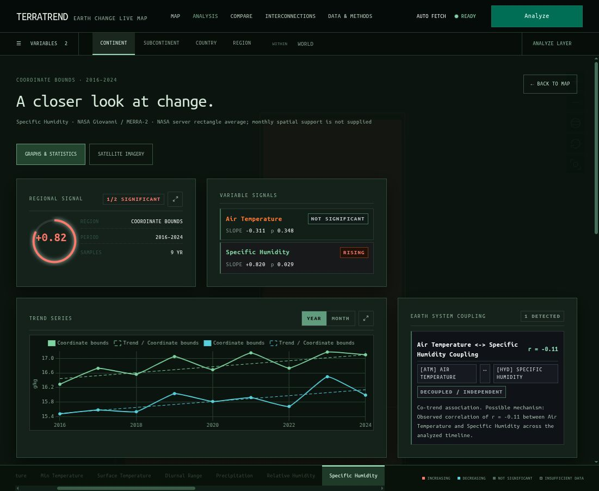

# Giovanni rectangle mode and remembered Earthdata connections

Implemented locally on 15 November 2026. Existing uncommitted work is retained.

Updated later the same day: the connector now includes 10 m temperature/humidity, preset rectangle layers and local relationships. AppEEARS, Hydrology, NOAA and linked-source modes are covered in [the completed source and preset report](SOURCES_AND_PRESETS.md). The first two-field live comparison below remains historical evidence for those specific requests.

## Choosing the processing method

**Data & Methods → Data source and processing** offers these two MERRA-2 methods alongside the additional source modes. The same choice is available in the investigation drawer. Selection alone starts no scientific request.

| Method | Selected area | Measurements | Scientific output |
| --- | --- | --- | --- |
| NASA MERRA-2 · exact boundaries | Countries, administrative regions, circles, triangles, lassos and bounds | Existing eight monthly mappings | Native-cell polygon overlap, monthly area support, cell trends, regional trends, A/B, geographic layers and exploratory interconnections |
| NASA Giovanni · rectangle summaries (preview) | One latitude/longitude rectangle, or two rectangles for comparison; curated focus boxes | Air temperature and specific humidity at 2 m and 10 m | NASA server-averaged monthly series; TerraTrend charts, Sen/Mann–Kendall analysis, discovery, A/B inference, local relationships, preset-box layers and CSV export |

Giovanni mode accepts coordinate bounds, curated focus boxes and axis-aligned rectangular lassos by checking the actual polygon. It rejects other shapes, holes, multipart selections and wide/dateline rectangles. A country's bounding box is never silently substituted for its boundary. Local relationships use the selected rectangle; layer analysis accepts actual rectangle presets. Country-boundary layers and remote country searches remain unsupported in this mode. No failure or unsupported shape triggers a native-grid download fallback.

The Giovanni method uses **M2IMNXASM 5.12.4**, monthly mean instantaneous assimilation diagnostics, collection **C1276812823-GES_DISC**, fields T2M, QV2M, T10M and QV10M. Its native spacing is 0.625° longitude × 0.5° latitude. Temperature converts K to °C; humidity converts kg/kg to g/kg. It is a different product from native mode's M2TMNXSLV. Matching variable names do not establish identical monthly values. Both added 10 m fields returned 108 valid months for the Ghana Savannah preset in 2016–2024.

A rectangle around Ghana includes places outside Ghana and cannot be described as an exact Ghana average. Even identical geographic extents can differ between methods because source products and boundary weighting differ. Neither method creates finer scientific resolution than the underlying grid. Giovanni does not report the monthly valid-area support needed to reproduce native mode's 80% coverage check. That limitation is explicit in the review and provenance; regional averages are never represented as fabricated cells or 100% coverage.

## Processing and data use

The backend submits a [NASA Harmony](https://harmony.earthdata.nasa.gov/docs) coverage request with `average=area`, `format=text/csv`, the rectangle and full requested dates. It follows bounded processing redirects, polls the job, validates the returned field/bounds/monthly dates, and downloads only its CSV. It handles the observed `GEOTIFF/CSV` link type by requiring a CSV filename. Authenticated Harmony output can redirect to a restricted NASA result-delivery location; Earthdata authorization is stripped before that destination. Login redirects are not followed with credentials.

Each response is limited to 2 MB. The review's smaller planning estimate is not a total traffic cap: status polling, metadata and transport overhead are additional. NASA processing time and credit limits can still affect a request. Regional series are cached for 24 hours by product/method version, field, exact rectangle and period. A cached parent average cannot provide averages for smaller regions.

The native adapter and its scientific aggregation are retained. Its exact-window cache behavior is unchanged; this integration does not implement containment reuse from a larger native download.

## Remembering the connection

**Remember this connection on this computer** saves the verified Earthdata token in the desktop secret service when available. The fallback is an atomic owner-only file under `~/.config/terratrend`, with directory permissions 0700 and file permissions 0600, outside the repository. The key is not returned through status APIs or stored in browser storage, scientific caches, URLs or logs.

Startup restores a remembered connection automatically. **Forget this connection** removes the saved credential and clears session memory. An operator's `EARTHDATA_TOKEN` environment variable remains independent. NASA can expire or revoke a token; local persistence does not extend its validity. Existing-session adoption is permitted only after remembering has been enabled.

Tests use isolated temporary credential directories and mock desktop-secret calls, preventing tests from reading or overwriting the user's real saved connection.

## Resource compatibility investigation

The [official challenge Resources tab](https://www.spaceappschallenge.org/2026/challenges/earth-system-trend-detective/?tab=resources) was read in the browser. All 13 links are recorded in [the resource inventory](CHALLENGE_RESOURCES.md).

The cloud catalogue checked during this investigation listed 867 configured variables. It did not list our eight original monthly M2TMNXSLV/M2TMNXLND/M2TMNXFLX mappings, and their Harmony capability responses did not offer Giovanni area averaging. M2IMNXASM advertises area averaging for the four implemented mappings. Its averaging service advertises bounding boxes, not shape averaging; shape subsetting belongs to a different service and cannot be borrowed.

Classic Giovanni has provisioned country/world-region and other shapes, so “Giovanni only supports rectangles” is not a correct statement about the whole product. Its [documented shape averaging](https://giovanni.gsfc.nasa.gov/giovanni/doc/UsersManualworkingdocument.docx.html) rasterizes boundaries before weighting, unlike TerraTrend's polygon clipping. Exact equivalence for our Ghana regions, custom circles or triangles has not been established. The optional cloud mode is intentionally scoped to the verified rectangle interface.

`backend/giovanni_capabilities.py` is a repeatable public-metadata audit of the full-replacement requirements. A capability match alone never declares a replacement scientifically validated. Raw capability snapshots, the official CSV schema, live observations, results and independent value checks are under [the evidence directory](local-handoff/giovanni-2026-11-15/).

## Validation

Tests were written and run RED before the corresponding implementation. Additional RED/GREEN regressions cover NASA's processing redirects, its live result-link schema, authorization stripping, cached retrieval timestamps and restart persistence. Fixture trends are not described as live observations.

Checks cover rectangle validation, source identity, fills/conversions, duplicate or nonmonthly records, incomplete years, independent A/B series, unknown spatial coverage, cancellation, caching, response limits, credential persistence/forgetting and UI request review. See the evidence directory for the final live verification summary and restart check.

## Initial two-field live verification

Two rectangles inside Ghana were independently analyzed for 2016–2024: A = west −2°, south 6°, east 0°, north 8°; B = west −1°, south 8°, east 0°, north 10°. Each of the four series returned 108 valid months and nine complete years. An independent CSV reader reproduced all 432 converted monthly values with zero discrepancy.

| Area | Measurement | Complete years | Sen change per decade | Adjusted MK p |
| --- | --- | --- | --- | --- |
| A | Air Temperature | 9 | -0.3109 °C | 0.3481 |
| A | Specific Humidity | 9 | +0.8204 g/kg | 0.0286 |
| B | Air Temperature | 9 | -0.2377 °C | 0.9170 |
| B | Specific Humidity | 9 | +0.8112 g/kg | 0.0476 |

These are per-measurement exploratory tests over a short window, not causal findings or evidence that the same trend holds across Ghana. Neither paired regional contrast was significant. The four returned source CSVs totaled **14,014 bytes**; metadata, polling, transport overhead and verification re-reads are additional. The native observation cache remained exactly **1,167 files / 35,428,316 bytes**, so no new native scientific grids were downloaded.

Both local servers were actually restarted and automatically restored Earthdata from the desktop credential store. The primary server repeated all four series using cached regional observations in approximately one second. Area-only discovery returned both supported fields from cache. The temporary server was then stopped; the normal app remains at http://127.0.0.1:8517/.

The browser verified processing settings, the remembered-connection state, rectangle selection, the transfer review, live A/B charts, significance labels and the regional-only spatial-evidence notice. Example exports retain both areas, M2IMNXASM provenance and blank unknown area-coverage fields.

Final validation: **182 backend tests and 64 frontend tests passed**, with 24 additional passing backend subtests and one intentionally skipped opt-in legacy network test. Standard-library trace measured line coverage of 94.8% for the Giovanni adapter, 96.2% for its compatibility audit, and 97.1% for credential storage. Syntax and whitespace checks passed. All original paths were preserved; HEAD remains `2fbda28faa2fb9467535d690669c610737457732`. Nothing was committed, pushed or deployed.

