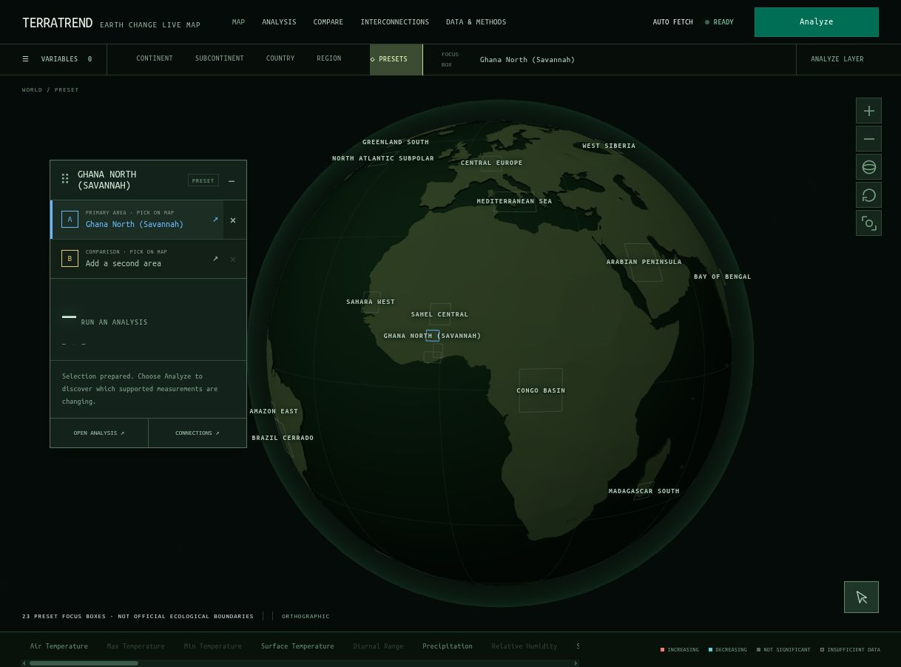
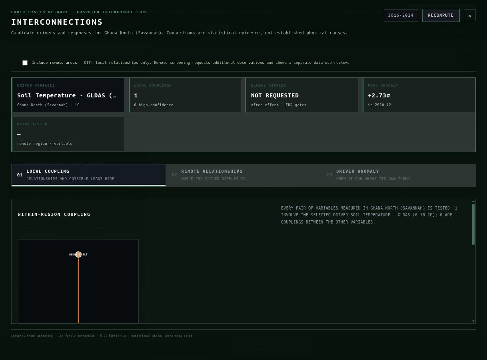

# Additional sources, linked measurements and focus presets

Implemented and verified locally on 15 November 2026. The normal app is at <http://127.0.0.1:8517/>. All preexisting uncommitted work is retained. Nothing has been committed, pushed or deployed.

## Intended outcomes

1. Switch the existing globe between administrative boundaries and the original named focus boxes. Keep independent A/B selections and projection controls. Selecting a preset does not start a download or imply an official ecosystem boundary.
2. Analyze MODIS monthly NDVI/EVI through AppEEARS polygon requests, retrieving summary files rather than raster bundles. Expose the service's separate connection and preserve quality/coverage limitations.
3. Retrieve monthly GLDAS series through the current Hydrology Time Series API with existing Earthdata authorization. Use actual source-grid centres and polygon overlap; never represent one point as a whole country.
4. Retrieve NOAA monthly station observations through its documented public NCEI access service. Use stations inside the actual polygon, retain a stable station cohort and label station summaries separately from area averages.
5. Add verified monthly measurements to Giovanni's rectangle mode.
6. Link explicitly identified measurements across providers over a common monthly calendar and geographic selection. Preserve product identity, units, resolution, missing data and provenance. Associations do not attribute the long-term trend or prove a physical cause.
7. Make local relationship screening the default; make remote searches explicit. Cache real observations and disclose first-request data use. Never prefetch all presets silently.

## Validation plan

Write and run failing tests before production changes; verify parsers against real service schemas and use clearly marked scientific fixtures for edge cases. Verify each available service with bounded live observations, then verify cache reuse. Never place credentials in evidence. Account actions that cannot be automated will have a working local connection form and specific instructions. Preserve the baseline hashes recorded in `/tmp/terratrend-before-sources-presets-2026-11-15.json`.

Test runners: `.venv/bin/python -m pytest backend -q -p no:cacheprovider`; `node --test tests/*.test.cjs`. Final verification includes browser interaction and screenshots. RED/GREEN results and any live-access limits will be recorded here as work completes.

## Using the additions

Open the variable drawer or **Data & Methods → Data source and processing**. Individual sources and **Linked datasets · NASA + NOAA** are selectable. Unsupported measurements remain disabled rather than being silently substituted. There are now **20 distinct live measurement IDs**, up from eight: two vegetation indices, three GLDAS measurements, five station measurements and two additional Giovanni measurements supplement the eight native mappings. Giovanni also offers its existing 2 m temperature and humidity; those duplicate IDs are not counted twice.

| Source | Measurements and product | Boundary and processing |
| --- | --- | --- |
| AppEEARS | NDVI and EVI; Terra MODIS MOD13A3.061 monthly, 1 km | Sends the actual polygon to NASA. Retrieves only its statistics CSV; no rasters or raster ZIPs are downloaded locally. NASA still processes raster data remotely. |
| Hydrology Time Series | GLDAS Noah 2.1 monthly: 0–10 cm soil water mass, soil temperature, near-surface wind | Requests a monthly history for **every** intersecting 0.25° source cell, then applies polygon overlap weights locally. At most 512 cells; no sparse sampling. |
| Climate Data Online observations | NOAA GSOM station mean/max/min temperature, wind and precipitation | Uses NOAA's public NCEI Access API, without a separate CDO v2 key. Selects stations inside the exact polygon, including holes. Fixed station cohort, equal station weights; this is not an area average. |
| Giovanni | M2IMNXASM 5.12.4: air temperature and specific humidity at **2 m and 10 m** | NASA rectangle averages. Bounds, rectangular lassos and curated preset boxes are supported. Other boundaries are rejected. |
| Native MERRA-2 | Existing eight mappings | Retains native grids, exact polygon weights, source-cell maps and monthly area-support checks. |

GLDAS soil water in kg/m² is separate from MERRA-2 saturation fraction. Near-surface model wind, station wind and the older unmapped 2 m wind ID are separate measurements. The interface keeps source names, instrument heights/depths where known, units and provenance visible.

AppEEARS uses a separate token issued after NASA username/password sign-in through the local form. The password is not saved. With **Remember** enabled, only issued tokens are stored in the desktop credential service, or the existing owner-only fallback outside the repository. Earthdata and AppEEARS were both restored after actual server restarts. AppEEARS may expire its service token after about 48 hours; remembering does not extend NASA's validity. Both connections are currently configured; the user need not enter them again for this completed check.

The **◇ Presets** toggle beside the geographic levels switches the same globe to **23 original focus boxes**, including Ghana North (Savannah), Ghana South, Congo Basin and Sahel Central. Select a box on the map or from the area list. The focus selector moves the view; it deliberately does not replace A or B. Toggle back to geographic boundaries at any time. These boxes are curated starting extents, not official ecological boundaries.

## Linking sources and interpreting the display

Choose **Linked datasets**, an area, two or three measurements and the period, then open **Interconnections**. The first selected measurement is the focus. The request review lists the actual measurements, source routes, selected extent and cold-cache estimate. **Include remote areas** is off by default; a local search does not scan seven other countries.

Each variable keeps its source product, monthly calendar, units and weighting. Seasonal/trend anomalies are aligned across overlapping months; the existing lag-family correction, full-family false discovery control and conditional checks remain in use. Results show the network plus incoming candidates, associated responses or **No clear temporal lead**. An undirected simultaneous link has no causal arrow. Each pair lists both sources and overlapping-month count. Source errors and insufficient coverage remain distinct from a relationship failing the statistical tests.

This is exploratory relationship screening. It does **not** establish the cause of a long-term trend or forecast its consequences. Shared geography and calendar do not make MODIS, GLDAS, MERRA-2 and station observations scientifically interchangeable. The explanation now correctly uses **r²**, not |r|, when describing shared variation. A surviving temperature control is not described as proof of a direct physical link.

## Data use, caching and coverage

The new routes make normal API requests for prepared time series or remote summaries. Returning data still transfers bytes, but the app does not automatically download full global raster archives. A first remote AppEEARS extraction can be slow even when the returned CSV is small. The Ghana 2016–2024 NDVI task took roughly **20 minutes on NASA's servers**; the returned scientific summary was **20,710 bytes**, rather than the approximately 387 MB remote raster output. Polling, metadata and network overhead add traffic. These timings and sizes are observed examples, not guarantees.

| Cache | Reuse and expiry |
| --- | --- |
| AppEEARS | Field + exact geometry revision + full period, 30 days. Repeating a request after restart resumes its saved NASA task identity rather than submitting the extraction again. In-memory local jobs themselves do not survive restart. |
| Hydrology | Field + native cell + period, 30 days. Overlapping regions reuse matching cell histories. |
| NOAA | Field + exact geometry revision + period, 24 hours. |
| Giovanni | Field + exact rectangle + period + method version, 24 hours. |
| Native MERRA-2 | Existing field + granule revision + native-window cache. Containment reuse from a larger window is not implemented. |

Presets help make requests repeatable and can use existing caches. **All 23 have not been prefetched**, and choosing one starts no download. A cached country or continent **average** cannot provide its subregions' values. Changed products, periods, boundaries or unmatched native windows may still need requests. The review estimates an empty cache and is not a hard traffic cap.

Continental AppEEARS and NOAA requests are bounded/rejected; Hydrology is limited to 512 cells and 60°S–90°N. Giovanni's current connector requires a rectangle. None of those limitations triggers an automatic large native-grid fallback.

Native and Hydrology aggregation require at least 80% selected-area support each month. AppEEARS summaries have fill/range checks but **no additional per-pixel VI quality filter or independently audited monthly valid-area fraction**. Giovanni does not supply monthly area support. NOAA stations require at least 80% monthly availability over the full requested period; each monthly mean needs 80% of that fixed cohort. Records with missing-day, failed-quality or precipitation-accumulation flags are excluded. Sparse stations, representativeness and homogenization remain limitations. Station results cannot color whole-country area-trend layers. None of these summary routes fabricates source-grid cells or 100% area coverage.

## Completed live checks

Evidence is in [sources-presets-2026-11-15](local-handoff/sources-presets-2026-11-15/). Values below are real observations; fixture tests are separate.

| Check | Observed result |
| --- | --- |
| Ghana NDVI, 2016–2024 | 108 valid monthly values, nine complete years. Independent comparison against NASA's physical-unit CSV means: **108/108 match exactly**. Sen −0.01364 index/decade; adjusted MK p=0.7098, nonsignificant. No extra MODIS raster scaling is applied to already-scaled summaries. |
| EVI, small Ghana polygon, 2024 | 12 valid monthly observations. A parser/service check only; one year is not used for a trend verdict. |
| Three GLDAS fields, one Ghana source cell, 2016–2024 | 108 months and nine complete years each. Independent source-CSV comparison: **324/324 match at declared output rounding**. All three annual trend tests were nonsignificant. |
| NOAA New York station area, 2016–2024 | One fixed cohort station, USW00094728. Temperature and rainfall have 108 valid months and nine complete years, both nonsignificant. Wind has observations but too few complete years under the strict missing-day rule. |
| NOAA Ghana, 2016–2024 | 15 candidate temperature stations but none meets the requested-period cohort rule; no wind candidates. Correctly reports insufficient data. |
| New Giovanni 10 m fields, Ghana Savannah, 2016–2024 | Both temperature and humidity returned 108 valid months and nine complete years. |
| Ghana root-zone moisture ↔ NDVI, 2016–2024 | Reused 108 native subsets and the AppEEARS summary. No source errors; no pair survived the relationship checks. No unsupported connection is drawn. |
| Ghana Savannah soil temperature ↔ 10 m air temperature, 2016–2024 | 80 GLDAS cells plus a Giovanni rectangle; 108 overlapping months. A simultaneous association r≈+0.65 passes corrected screening (adjusted p≈5.83×10⁻⁷). Neither measurement has a resolved lead. This does not establish that one causes the other. |

The user's previously running eight-field Ghana discovery completed and its result was saved before restarting. These checks did not replace that work with fixtures or discard its cache.

## Regression and review evidence

Final suite: **217 backend tests passed, one opt-in legacy network test skipped, 43 passing backend subtests; 68 frontend tests passed**. JavaScript syntax and `git diff --check` passed. Standard-library tracing measured line execution coverage of 100% Hydrology, 99.1% NOAA, 98.8% AppEEARS and 97.6% separate service credentials. This is line coverage, not branch coverage or a guarantee of remote-service availability.

| Guarantee | Test target | Observed RED → GREEN |
| --- | --- | --- |
| Preset selection and actual GLDAS grid phase | `test_sources_presets.py`, `test_hydrology_data.py`, `workflow.test.cjs` | Missing preset/grid contracts failed; named boxes and shifted native centres passed. |
| New source parsing, QA, conversions and bounds | `test_appeears_data.py`, `test_station_data.py`, `test_hydrology_data.py` | Missing adapters and schema/quality regressions failed; supported schemas and explicit insufficiency passed. |
| Cross-source identity and local-only default | `test_sources_presets.py`, `workflow.test.cjs`, `data-review.test.cjs` | Missing routing/default/source errors failed; actual routing, selected companions and no implicit remote requests passed. |
| Four Giovanni fields and rectangle layers/local relationships | `test_giovanni_data.py`, `test_sources_presets.py`, `workflow.test.cjs` | Two-field expectations/unsupported new paths failed before implementation; four fields and actual rectangular presets passed. |
| AppEEARS restart, NASA progress and delivery redirects | `test_source_transport.py` | Unrecognized live status/303/302 schemas failed; exact task/CDN destinations passed with credentials stripped from delivery. |
| Physical-unit vegetation summary | `test_appeears_data.py`, `test_source_transport.py` | Double-scaling regression failed; NASA's physical summary means are preserved, unverified packed values rejected. |
| Station coverage is not a country layer | `test_sources_presets.py` | Whole-area station layer assertion failed before guard; Analysis/Compare remain available with station provenance. |
| Correlation explanation | `test_interconnect.py` | r=.65 incorrectly described 65% shared variation; corrected to 42%, nonzero p formatting and explicit attribution limits. |

No checkpoint commits were made because the active user instruction is to preserve all uncommitted work. Browser checks cover the preset toggle, source settings, remembered connections, Ghana's live NDVI chart, two-source request review and the computed relationship network.

## Primary service references

- [NASA AppEEARS API](https://appeears.earthdatacloud.nasa.gov/api/) and [MOD13A3.061 product](https://doi.org/10.5067/MODIS/MOD13A3.061).
- [NASA's current time-series service tutorial](https://github.com/nasa/gesdisc-tutorials/blob/main/notebooks/How_to_Access_GiC_Time_Series_Service.ipynb) and [GLDAS monthly product](https://doi.org/10.5067/SXAVCZFAQLNO).
- [NOAA Access data API](https://www.ncei.noaa.gov/support/access-data-service-api-user-documentation), [station search API](https://www.ncei.noaa.gov/support/access-search-service-api-user-documentation), and [GSOM format and quality flags](https://www.ncei.noaa.gov/data/gsom/doc/GSOM_documentation.pdf), including AWND on p.4, PRCP on p.12, TAVG/TMAX/TMIN on pp.13–14 and quality/source definitions on pp.18–20.
- [Giovanni scope and earlier live checks](GIOVANNI_INTEGRATION.md); [all 13 challenge resources](CHALLENGE_RESOURCES.md).
