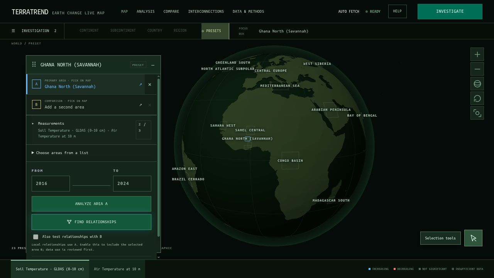
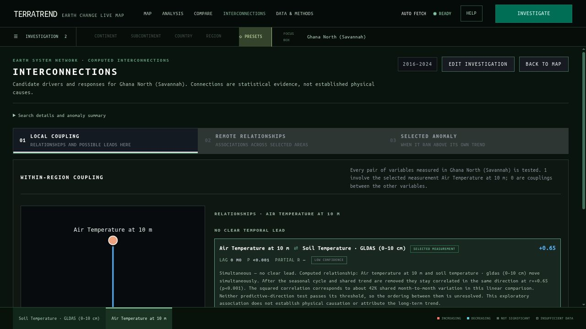

# Investigation workflow, 15 November 2026

The user approved the ranked 14-task interface plan with “do it.” All work was performed in the existing checkout. The app runs at <http://127.0.0.1:8517/>. No commit, reset, clean, push or deployment was performed by this task.

## What changed

| Approved priority | Result |
| --- | --- |
| 1. Retain results | Navigation never toggles comparison mode or clears a result. Editing prepares new inputs while retaining previous evidence with its original context. A bounded in-page result list restores completed investigations; identical completed requests reuse their result. |
| 2. Clarify scope | One primary action: Analyze Area A, Compare A + B, or Discover Trends in A. The header opens the investigation. Whole-layer processing is under More investigations and names its displayed-area count; it uses the first measurement. |
| 3. One workspace | The existing draggable A/B card now contains a collapsible measurement picker, native checkboxes, search/sphere filters, dates and run actions. Long choices scroll; dates/actions remain reachable. The prior placeholder summary is a disclosure for the last completed result. |
| 4. Automatic data | The default Automatic provider routes by measurement and actual geometry. Source selectors are removed from the basic investigation and retained as advanced overrides. Results and request reviews name actual products. |
| 5. Compatible shapes | A read-only preflight precedes the data-use review. Unsupported shapes/large extents produce measurement/area-specific guidance. Rectangle recovery activates the bounds tool without replacing the existing area. Incompatible tools are disabled with explanations for rectangle-only selections. |
| 6. Analysis/Compare | Both use the same completed evidence. With A only, Compare retains A and offers Add comparison area B. A/B results and missing comparison readiness stay distinct. |
| 7. Interconnections page | Fits under normal navigation, uses the current investigation and starts no request on navigation. Find relationships is the explicit action. At least two chosen measurements are required in Automatic/Linked mode; a single focus gets companion guidance. |
| 8. Globe evidence | Remote screening is limited to the explicitly selected B. Show on map retains the computed connections, a variable-colour key, hover evidence and up to four pinned cards. Each card opens both real yearly histories with distinct A/B styling and their own units. |
| 9. Readable network | Diagram nodes use full measurement names. Temporal leads retain directional evidence; simultaneous links have no arrow. Statistical associations are not presented as proven causes. |
| 10. Plain meanings | Signal rates include units per decade. A contextual explanation covers significance, p, correlation and insufficient data. Area/measurement identities remain attached to charts and restored results. |
| 11. Chart tooltips | Main and expanded graphs show observed value, fitted trend and signed distance above/below trend. Expanded monthly graphs convert their display index to the actual calendar before evaluating the fitted line. Gaps remain gaps. |
| 12. Connections | Connected/remembered badges replace login forms. Updating or forgetting a connection is deliberate; credentials never appear in results or browser storage. Saved Earthdata and AppEEARS connections survived a real restart. |
| 13. Tutorial | An eight-step, skippable walkthrough highlights the real controls without starting downloads. Help replays it. Keyboard focus and Escape/Tab handling are included. |
| 14. Colours | Blue for increases/above-trend, red for decreases/below-trend. Neutral nonsignificant/missing states remain distinct. Region A/B and measurement identity colours are separate from direction colours. |

The globe avoids projection/GPU work while hidden and caps visible redraws to approximately 30 frames/second. Existing projection, wheel, lasso, independent A/B and geometry behavior remain covered by regression tests.

## Automatic routing and review

`data_sources.automatic_route` and `plan_request` share the routing decision with execution. `POST /api/plan` registers only supplied custom geometries and prepares a read-only plan: source routes, compatible fields, exclusions and recovery issues. It fetches no observations. Jobs recalculate the plan; client-supplied routing is not trusted for scientific retrieval. The paired-area context is isolated with a ContextVar and reset after execution.

| Measurement | Automatic route |
| --- | --- |
| T2M / QV2M | Giovanni M2IMNXASM only when all involved areas are compatible rectangles. Otherwise native MERRA-2 M2TMNXSLV for every area, retaining paired product identity. |
| T10M / QV10M | Giovanni, rectangles only. A country is not replaced by its bounding box. |
| Other six original live fields | Their existing native MERRA-2 mappings. No unverified Giovanni precipitation substitution. |
| NDVI / EVI | AppEEARS actual polygon summaries, with the existing quality/area limits. |
| GLDAS fields | Every intersecting native-cell history, at most 512 cells. |
| Station fields | NOAA fixed station cohorts inside the polygon, not area averages or country-colour layers. |

Discovery excludes geometrically unsupported measurements and discloses that exclusion; the displayed field list and estimate use those compatible fields. Selected incompatible measurements stop before observation requests. Remote review counts only the chosen companion fields and B, not the former default list or seven unrelated countries. Estimates remain cold-cache planning allowances, not hard traffic limits.

Automatic routing does not make different products equivalent. Country-versus-rectangle temperature/humidity comparisons can use more data because both retain the native product. A kilometre-based square is not necessarily an axis-aligned coordinate rectangle. The existing source quality, coverage, expiry and coarse-resolution limits still apply; see [source details](SOURCES_AND_PRESETS.md).

## Evidence

The [local evidence folder](local-handoff/ui-workflow-2026-11-15/) contains job results, a restart check, coverage and the final preservation/verification records. Real checks used the existing scientific caches; fixtures are identified by their tests.

- Ghana Savannah, 2016–2024: GLDAS upper-soil temperature (80 cached native-cell histories) and Giovanni 10 m air temperature (cached summary), both nine complete years. The annual trends were nonsignificant. Their deseasonalized/detrended monthly relationship is simultaneous, r≈+0.65, with 108 overlapping months; no temporal lead is resolved.
- Two separate coordinate rectangles inside Ghana: A = −2°W to 0°, 6–8°N; B = −1°W to 0°, 8–10°N. T2M and QV2M each returned 108 months per area from cache. The request named only these two areas and two measurements. The earlier source checks independently verified these values.
- Remote screening of those rectangles tested exactly two B measurement targets. One real air-temperature relationship survived, r≈+0.78, simultaneous. The browser verified its map link, pinned evidence and the two-history chart. This is a bounded example, not evidence of physical causation or global coverage.
- Navigation through Analysis, Compare, Map and Interconnections retained the completed investigation. Entering Interconnections alone showed readiness rather than starting work.
- Ghana plus 10 m temperature produced the specific rectangle message and opened coordinate bounds through its recovery button while retaining Ghana. No observation request was submitted for that incompatible selection.
- Both remembered NASA connections restored in the normal app after an actual restart; no account action was needed.

Final automated checks: **224 backend tests passed, one opt-in legacy network test skipped, 43 passing backend subtests; 79 frontend tests passed.** Syntax, unique HTML IDs and whitespace checks passed. Standard-library tracing measured 100% line execution coverage of the new router/preflight functions; this is not branch coverage. Browser checks cover native checkboxes, filters, dates, scope review, recovery, tutorial, connected states, real results, navigation and relationship evidence.

Observed RED → GREEN regressions include navigation clearing a completed result; input editing discarding evidence; unexpected remote target areas; missing tooltip trend distance; absent automatic routing; mixed-shape paired product identity; missing legend containers after consolidation; inflated remote estimates; discovery listing incompatible fields; arc colours/overlay retention; reversed direction colours; and hidden maps performing redraw work. No checkpoint commits were made because the user's instruction is to preserve uncommitted work.

## Persistence boundaries

The in-page history holds up to six distinct completed analyses and up to twelve completed request results while the page remains open. A full browser reload starts a fresh investigation; it does not erase remembered service connections or scientific disk caches. In-memory server jobs do not survive restarts. AppEEARS may expire its issued token despite local remembering. These limits are unchanged by navigation retention.

The preexisting deletion of `backend/literature.py` is retained. All baseline paths were checked before finishing; no unrelated work was reset or removed.

A newer native analysis was observed after the verification jobs and left running. It is recorded separately in verification.json, not counted as a completed check.
